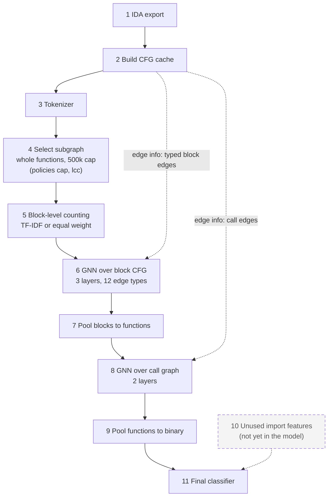

# Block-level counting + GNN

This is the block-level counting model, path 3 of the team plan. Each basic block becomes a vector by counting its
tokens (opcodes, instruction signatures, behaviour tags and API references), weighted by TF-IDF or equally. A
GNN passes typed messages over each function's block CFG. Blocks are pooled into function vectors, a second GNN
runs over the call graph, functions are pooled into one binary vector, and an MLP gives the ransomware logit.
Subgraph selection keeps the whole binary up to a block budget (500,000 blocks by default; the `lcc` policy and smaller
budgets are options). There are no unused-import features yet.

The packages under `pipeline/` are numbered like the boxes of the diagram below.

## Pipeline



The dashed box is not in the model yet: step 10 does not exist. Step 4 keeps the whole binary by default; the other policies
are options.

## Steps and code

| step | package | key functions / classes | inputs → outputs | RunConfig switches |
|---|---|---|---|---|
| 1 IDA export | `pipeline/s01_ida_export` | (README only; the export runs on the VM) | PE binary → `<sha256>.jsonl.gz` | none |
| 2 Build CFG cache | `pipeline/s02_build_cfg_cache` | `build_cache.py`, `check_cache.py` | exports → `samples/<id>.npz`, `index.csv`, `vocab.json` | `GT_CACHE` (env), `protocol` picks the cache |
| 3 Tokenizer | `pipeline/s03_tokenizer` | `TokenVocab`, `token_table`, `ranges` | npz arrays → `tokens`, `tok_offsets` | `min_df` |
| 4 Select subgraph | `pipeline/s04_select_subgraph` | `select_subgraph`, `cap_functions`, `MAX_BINARY_BLOCKS`, `chain_reduction`; `keep_functions` in `batching.py` | functions of a binary → kept functions, `seg_len`, `seg_feat`, `blk_seg`, `blk_pos` | `subgraph` (`cap`, `lcc`), `budget`, `drop_functions`, `drop_library`, `batch_blocks` |
| 5 Block-level counting | `pipeline/s05_block_counting` | `token_weights`, `BlockEncoder` | `tokens`, `tok_weights`, `blk_feat` → block vectors `[B, d]` | `encoder` (`tfidf`, `mean`, `raw`, `presence`, `rawlog`), `mask_blocks`, `mask_tokens`, `d_model` |
| 6 GNN over block CFG | `pipeline/s06_gnn_block_cfg` | `block_edges`, `control_edges`, `drop_and_flip_edges`, `DirGINELayer` | block vectors, `edge_seg/src/dst/type` → block vectors | `gnn_fn_layers`, `direction`, `control`, `untyped`, `drop_edges`, `flip_edges` |
| 7 Pool blocks to functions | `pipeline/s07_pool_blocks_to_functions` | `FixedReadout`, `GatedReadout` | block vectors, `blk_seg` → function vectors `[S, d]` | `readout` (`fixed`, `gated`; `gated` is attention pooling) |
| 8 GNN over call graph | `pipeline/s08_gnn_call_graph` | `call_pairs`, `call_layers`, `run_call_layers` | function vectors, `call_src/dst` → function vectors | `gnn_bin_layers`, `no_call_mp` |
| 9 Pool functions to binary | `pipeline/s09_pool_functions_to_binary` | the readouts of step 7 | function vectors, `seg_bin` → binary vectors `[N, d]` | `readout` |
| 10 Unused import features | `pipeline/s10_unused_import_features` | none (README only) | not built | none |
| 11 Final classifier | `pipeline/s11_final_classifier` | `make_head`, `bin_feat` | binary vector, `bin_feat` → logit `[N]` | `dropout`, `stack_tfidf` (deferred), `select_on` (`overall`, `cell`: how `train.py` picks the AUC checkpoint and its threshold) |

`pipeline/batching.py` builds one binary's arrays from steps 3 to 8 (`encode_binary_gnn`), collates them and loads
batches. `pipeline/model.py` assembles `HierGNN` from the stages. Its attribute names are the checkpoint keys, so
do not rename them. The controls (`no_edges`, `untyped`, `no_call_mp`) are applied in `HierGNN.structure`.

## Other folders

| folder | content |
|---|---|
| `common/` | `RunConfig` (`config.py`), cache and run paths (`paths.py`), manifests and folds (`manifests.py`) |
| `training/` | `train.py`, one run |
| `evaluation/` | `metrics.py`, `baselines.py`, `report.py`, `stats.py`, `gates.py`, `val_threshold.py` |
| `experiments/side_arrays/` | side arrays and the WL baseline (see `SIDE_EXPERIMENTS.md`) |
| `legacy/graph_transformer/` | the earlier graph transformer and its per-binary arrays |
| `scripts/` | `queue_gnn.sh`, `stop_queue.sh`, `smoke_gnn_memory.py` |
| `docs/` | `PLAN.md`, `PLAN_GNN.md`, `RESULTS.md` |
| `tests/` | all tests |

The scripts in this folder (`train.py`, `baselines.py`, `report.py`, `stats.py`, `gates.py`, `val_threshold.py`,
`build_cache.py`, `check_cache.py`, `build_side.py`, `wl_baseline.py`, `smoke_gnn_memory.py`, `subgraph_chain.py`, `queue_gnn.sh`,
`stop_queue.sh`) are thin shims. They call the real code in the folders above, so the old commands still work.

## Quickstart

Run everything from this folder, `CT_GAT/block_level_counting/`.

- Python: `C:/Users/chaoa/Downloads/gt_venv/Scripts/python.exe` (3.12, torch with CUDA, numpy, scipy, scikit-learn, pytest).
- v2 cache (Mendeley, the default): `C:/Users/chaoa/Downloads/graph_transformer_cache_v2`.
- Combined cache (`--protocol kfold_v3`): `C:/Users/chaoa/Downloads/graph_transformer_cache_combined`. `GT_CACHE` overrides both.
- Run directories: `C:/Users/chaoa/Downloads/graph_transformer_runs`.
- IDA exports: see `pipeline/s01_ida_export/README.md`.

```bash
PY=C:/Users/chaoa/Downloads/gt_venv/Scripts/python.exe

# one GNN run (fold 0, x86, seed 0, 15% block masking); writes graph_transformer_runs/kfold0_x86_gnn-mblk15_s0/
$PY train.py --protocol kfold --fold 0 --arch x86 --seed 0 --model gnn --mask-blocks 0.15

# TF-IDF and structural baselines on the same folds
$PY baselines.py --protocol kfold --fold 0 1 2 3 4 --arch x86 --seed 0

# rebuild docs/RESULTS.md from every run directory
$PY report.py

# paired test: no-edge control against typed edges, AUC-selected checkpoints
$PY stats.py --a kfold_x86_gnn-noedges --b kfold_x86_gnn --selection auc

# gate summary of a stage, and the resumable queue (--dry only prints the runs); stages day1, day1b, v3, subgraph
$PY gates.py --stage day1b
bash queue_gnn.sh --stage day1b --dry

# v3 arms pick the AUC checkpoint and its threshold by validation cell-balanced metrics: --select-on cell
$PY train.py --protocol kfold_v3 --fold 0 --arch all --model gnn --mask-blocks 0.15 --arch-balance --select-on cell

# subgraph policies and block-count weightings (run names end -sg-lcc20k, -enc-rawlog, ...)
$PY train.py --protocol kfold --fold 0 --model gnn --mask-blocks 0.15 --subgraph lcc --budget 20000
$PY train.py --protocol kfold --fold 0 --model gnn --control no_edges --mask-blocks 0.15 --encoder rawlog

# peak GPU memory on the combined cache, and the chain-merge measurement (writes graph_transformer_runs/subgraph_chain.json)
$PY smoke_gnn_memory.py --protocol kfold_v3 --mask-blocks 0.15
$PY subgraph_chain.py

# tests (GPU and caches needed for some)
$PY -m pytest tests -q
```

## Evaluation protocol

1. Family holdout: whole ransomware families and whole goodware identity groups are held out in 5 folds; the headline is x86 only.
2. A validation set is carved from the training pool in the same way (about 15% of whole families and groups).
3. The checkpoint with the best validation AUC is scored on the test fold at the validation threshold (the grid value with the best validation macro-F1).
4. The rule is fixed in advance: a paired cluster bootstrap over 3 seeds x 5 folds, with dAUC >= 0.01 and dmacro-F1 >= 0.02, and a CI that excludes zero.
5. Typed edges must beat both controls, the no-edge model (`--control no_edges`) and the degree-preserving shuffled edges (`--control shuffle`).

## Where to read more

- `docs/PLAN_GNN.md`: decisions, gates and results. `docs/LITERATURE_REVIEW.md`: the design rationale for every choice, with sources.
- `docs/RESULTS.md`: the results table that `report.py` generates.
- `experiments/side_arrays/SIDE_EXPERIMENTS.md`: the side-array and WL experiments.

## Where new work goes

- Tokenizer variants: `pipeline/s03_tokenizer`.
- Subgraph policies (which functions or blocks enter the model): `pipeline/s04_select_subgraph/subgraph.py`. A new policy is a
  branch of `select_subgraph` and a value of `RunConfig.subgraph`.
- Precomputed block vectors: `pipeline/s05_block_counting`.
- Import features: `pipeline/s10_unused_import_features`.

A new `RunConfig` field also needs a change in `common/config.py`. Check that `RunConfig().name` and the names of
existing runs stay the same.
