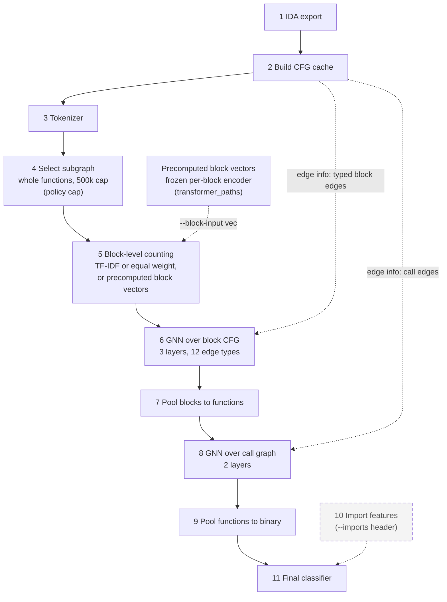

# Block-level counting + GNN

This is the block-level counting model, path 3 of the team plan. Each basic block becomes a vector by counting its
tokens (opcodes, instruction signatures, behaviour tags and API references), weighted by TF-IDF or equally. A
GNN passes typed messages over each function's block CFG. Blocks are pooled into function vectors, a second GNN
runs over the call graph, functions are pooled into one binary vector, and an MLP gives the ransomware logit.
Subgraph selection keeps the whole binary up to a block budget (500,000 blocks by default; smaller budgets are an option, policy `cap`
only). Two options use the team's reader output (`IDA_FEATURE_READERS.md`): `--imports header` adds a bag of every import in the binary's
header to the final classifier (off by default), and `--vocab yanping|hybrid` swaps the instruction tokens for the reader's operand-role ids.
`--vocab yanping|hybrid` and the side arrays are experiments, not on the main path.

The packages under `pipeline/` are numbered like the boxes of the diagram below.

## Pipeline



The dashed box is an option, off by default (`--imports header`, see Reader inputs below). Step 4 keeps the whole binary by
default; a smaller block budget is an option. Step 5 can take precomputed block vectors from a frozen per-block encoder instead of the token counts
(`--block-input vec`, see Transformer paths below).

## Steps and code

| step | package | key functions / classes | inputs → outputs | RunConfig switches |
|---|---|---|---|---|
| 1 IDA export | `pipeline/s01_ida_export` | (README only; the export runs on the VM) | PE binary → `<sha256>.jsonl.gz` | none |
| 2 Build CFG cache | `pipeline/s02_build_cfg_cache` | `build_cache.py`, `check_cache.py` | exports → `samples/<id>.npz`, `index.csv`, `vocab.json` | `GT_CACHE` (env), `protocol` picks the cache |
| 3 Tokenizer | `pipeline/s03_tokenizer` | `TokenVocab`, `token_table`, `ranges` | npz arrays (and `side/yanping` for `vocab` ≠ `ours`, an experiment: converter `experiments/side_arrays/import_reader_side.py`) → `tokens`, `tok_offsets` | `min_df`, `vocab` (`ours`, `yanping`, `hybrid`, `noapi`) |
| 4 Select subgraph | `pipeline/s04_select_subgraph` | `select_subgraph`, `cap_functions`, `MAX_BINARY_BLOCKS`, `chain_reduction`; `keep_functions` in `batching.py` | functions of a binary → kept functions, `seg_len`, `seg_feat`, `blk_seg`, `blk_pos` | `subgraph` (`cap`), `budget`, `drop_functions`, `drop_library`, `batch_blocks` |
| 5 Block-level counting | `pipeline/s05_block_counting` | `token_weights`, `BlockEncoder`, `BlockVecEncoder`, `BlockVecs`, `BlockVecSource` | `tokens`, `tok_weights`, `blk_feat` → block vectors `[B, d]`; with `block_input='vec'`: `blk_vec`, `blk_feat` → block vectors | `encoder` (`tfidf`, `mean`, `raw`, `presence`, `rawlog`), `mask_blocks`, `mask_tokens`, `d_model`, `block_input` (`tokens`, `vec`), `block_vec` |
| 6 GNN over block CFG | `pipeline/s06_gnn_block_cfg` | `block_edges`, `control_edges`, `drop_and_flip_edges`, `DirGINELayer` | block vectors, `edge_seg/src/dst/type` → block vectors | `gnn_fn_layers`, `direction`, `control`, `untyped`, `drop_edges`, `flip_edges` |
| 7 Pool blocks to functions | `pipeline/s07_pool_blocks_to_functions` | `FixedReadout`, `GatedReadout` | block vectors, `blk_seg` → function vectors `[S, d]` | `readout` (`fixed`, `gated`; `gated` is attention pooling) |
| 8 GNN over call graph | `pipeline/s08_gnn_call_graph` | `call_pairs`, `call_layers`, `run_call_layers` | function vectors, `call_src/dst` → function vectors | `gnn_bin_layers`, `no_call_mp` |
| 9 Pool functions to binary | `pipeline/s09_pool_functions_to_binary` | the readouts of step 7 | function vectors, `seg_bin` → binary vectors `[N, d]` | `readout` |
| 10 Import features (header) | `pipeline/s10_unused_import_features` | `import_side` (converter), `ImportVocab`, `ImportBag` | `side/imports` → import bag `[N, 32]` and 2 log counts | `imports` (`header`) |
| 11 Final classifier | `pipeline/s11_final_classifier` | `make_head`, `bin_feat` | binary vector, `bin_feat` (and the import bag, the TF-IDF logit) → logit `[N]` | `dropout`, `stack_tfidf` (out-of-fold TF-IDF logit from `baselines.py --stack-logits`), `select_on` (`overall`, `cell`: how `train.py` picks the AUC checkpoint and its threshold) |

`pipeline/batching.py` builds one binary's arrays from steps 3 to 8 (`encode_binary_gnn`), collates them and loads
batches. `pipeline/model.py` assembles `HierGNN` from the stages. Its attribute names are the checkpoint keys, so
do not rename them. The controls (`no_edges`, `untyped`, `no_call_mp`) are applied in `HierGNN.structure`.

## Other folders

| folder | content |
|---|---|
| `common/` | `RunConfig` (`config.py`), cache and run paths (`paths.py`), manifests and folds (`manifests.py`), shared code of the reader converters (`side_io.py`) |
| `training/` | `train.py`, one run |
| `evaluation/` | `metrics.py`, `baselines.py`, `report.py`, `stats.py`, `gates.py`, `val_threshold.py` |
| `experiments/side_arrays/` | experiment, not on the main path: side arrays, the WL baseline (see `SIDE_EXPERIMENTS.md`) and the converter of the reader's operand roles (`import_reader_side.py`, for `--vocab yanping|hybrid`) |
| `transformer_paths/` | block dataset export, reader, encoder contract, reference encoder, block-vector precompute (see Transformer paths) |
| `scripts/` | `queue_gnn.sh`, `stop_queue.sh`, `smoke_gnn_memory.py` |
| `docs/` | `PLAN.md`, `PLAN_GNN.md`, `RESULTS.md` |
| `tests/` | all tests |

The scripts in this folder (`train.py`, `baselines.py`, `report.py`, `stats.py`, `gates.py`, `val_threshold.py`,
`build_cache.py`, `check_cache.py`, `build_side.py`, `wl_baseline.py`, `smoke_gnn_memory.py`, `subgraph_chain.py`, `queue_gnn.sh`,
`stop_queue.sh`) are thin shims. They call the real code in the folders above, so the old commands still work.

## Quickstart

Run everything from this folder, `CT_GAT/block_level_counting/`.

- Python: `C:/Users/chaoa/Downloads/gt_venv/Scripts/python.exe` (3.12, torch with CUDA, numpy, scipy, scikit-learn, pytest).
- v2 cache (Mendeley, the default): `C:/Users/chaoa/Downloads/graph_transformer_cache_v2`.
- Combined cache (`--protocol kfold_v3`): `C:/Users/chaoa/Downloads/graph_transformer_cache_combined`. `GT_CACHE` overrides both.
- Run directories: `C:/Users/chaoa/Downloads/graph_transformer_runs`.
- IDA exports: see `pipeline/s01_ida_export/README.md`.

```bash
PY=C:/Users/chaoa/Downloads/gt_venv/Scripts/python.exe

# one GNN run (fold 0, x86, seed 0, 15% block masking); writes graph_transformer_runs/kfold0_x86_gnn-mblk15_s0/
$PY train.py --protocol kfold --fold 0 --arch x86 --seed 0 --model gnn --mask-blocks 0.15

# TF-IDF and structural baselines on the same folds
$PY baselines.py --protocol kfold --fold 0 1 2 3 4 --arch x86 --seed 0

# rebuild docs/RESULTS.md from every run directory
$PY report.py

# paired test: no-edge control against typed edges, AUC-selected checkpoints
$PY stats.py --a kfold_x86_gnn-noedges --b kfold_x86_gnn --selection auc

# gate summary of a stage, and the resumable queue (--dry only prints the runs); stages day1, day1b, v3, subgraph, paths, vocab, imports, imports_header
$PY gates.py --stage day1b
bash queue_gnn.sh --stage day1b --dry

# v3 arms pick the AUC checkpoint and its threshold by validation cell-balanced metrics: --select-on cell
$PY train.py --protocol kfold_v3 --fold 0 --arch all --model gnn --mask-blocks 0.15 --arch-balance --select-on cell

# block budgets and block-count weightings (run names end -sg-cap20k, -enc-rawlog, ...)
$PY train.py --protocol kfold --fold 0 --model gnn --mask-blocks 0.15 --subgraph cap --budget 20000
$PY train.py --protocol kfold --fold 0 --model gnn --control no_edges --mask-blocks 0.15 --encoder rawlog

# peak GPU memory on the combined cache, and the chain-merge measurement (writes graph_transformer_runs/subgraph_chain.json)
$PY smoke_gnn_memory.py --protocol kfold_v3 --mask-blocks 0.15
$PY subgraph_chain.py

# out-of-fold TF-IDF logits (RUNS/baselines/<dir>/stack_logits.csv), then a GNN that takes them as a head input
$PY baselines.py --protocol kfold --fold 0 1 2 3 4 --arch x86 --seed 0 --stack-logits
$PY train.py --protocol kfold --fold 0 --arch x86 --seed 0 --model gnn --mask-blocks 0.15 --stack-tfidf

# tests (GPU and caches needed for some)
$PY -m pytest tests -q
```

## Reader inputs: header imports, and the operand-role vocabulary (experiment)

The team's readers (`CT_GAT/preprocessing/ida_feature_readers.py`, documented in `CT_GAT/IDA_FEATURE_READERS.md`) write, per binary,
`<reader root>/<sample_id>/{operand_roles.jsonl.gz, imports.json, manifest.json}` (default reader root
`C:/Users/chaoa/Downloads/ida_features/out`). Two converters turn that output into cache-aligned side arrays; neither reads the raw
IDA export, and both fail a sample (listing it) when the reader output does not describe the cache's binary.

| converter | writes | content |
|---|---|---|
| `python -m experiments.side_arrays.import_reader_side --cache <cache> ...` (experiment) | `<cache>/side/yanping/<sample_id>.npz` | `ytok` int16 `[n_insn, 3]`, the reader's triplet (opcode or API id, operand 1, operand 2) in the cache's instruction order, plus schema and provenance |
| `python -m pipeline.s10_unused_import_features.import_side --cache <cache> ...` | `<cache>/side/imports/<sample_id>.npz` | the header, referenced and unreferenced import identities (`dll!name`, lowercased) as the reader gives them |

Both take several caches in one call (the reader output of a binary the caches share is parsed once), skip a sample whose provenance
is unchanged, print `{ok, failed, missing}` counts, list each failure on stderr and write `side/<name>/_build-<id>.json`. A sample
whose reader output is not there yet is `missing`, not failed. The alignment check covers the complete footer, the function, block and
instruction counts, the instruction count of every block, the function of every block (empty functions included), the slot ranges, and
one reader opcode id per cache mnemonic.

- `--vocab yanping` (experiment, not on the main path): the block bag holds the reader's three ids per instruction plus our `api` tokens. `--vocab hybrid`: our `mn` and
  `beh`, the reader's two operand ids, and `api`. `TokenVocab` cuts the reader kinds on the training binaries like `mn`, `sig` and
  `api` (document frequency at least `min_df`, UNK = 0, one `[MASK]` id per kind); `beh` stays whole as before. The run name gains
  `-voc-<name>`; `--vocab ours` (the default) leaves every name, vocabulary and checkpoint as it was.
- `--vocab noapi` (the api-token ablation, `gnn-mblk15-voc-noapi`): the block bag holds `mn`, `sig` and `beh` and no `api` token; `TokenVocab`
  has no `api` kind, offset, mask id or idf slot, and `token_table` returns an empty `api_pos`. The header-import features (`--imports`) are a
  separate switch and are untouched. The matching TF-IDF is `baselines.py --vocab noapi`: method `tfidf_noapi_lr` over `mn`, `sig` and `beh`
  (the kinds of this vocabulary; the default `tfidf_sig_api_lr` counts `sig` and `api`), plus `tfidf_sig_lr` (the default's kinds minus api),
  in `kfold<f>_x86_s0_voc-noapi`; gate group `tfidf-noapi`. `scripts/noapi_runs.sh` runs the baseline, the 15 GNN runs (seeds 0 1 2, folds 0-4)
  and `gates.py --stage noapi`.
- `--imports header`: `ImportVocab` keeps the import identities present in at least `min_df` (2) training binaries, referenced or not,
  with idf; an `EmbeddingBag` over the binary's kept names (weights: idf, L2-normalised), plus log1p(#unreferenced) and log1p(#header
  imports), enter the head. The run name gains `-imph`. Header imports alone separate the classes well (the `imports_header_lr`
  baseline), which is why the option exists; it is a binary-level input, not evidence about the code graph. The earlier
  `--imports unreferenced` (a bag of the imports no instruction references, suffix `-imp`) was removed in step 25: its baseline had
  pooled AUC 0.526 and its R7 arm never ran. The unreferenced count stays in the two log counts so that the finished `-imph` runs
  reproduce.
- Baselines: `baselines.py --vocab yanping|hybrid` writes `tfidf_<vocab>_lr` to `kfold<f>_x86_s0_voc-<vocab>`; `baselines.py --imports`
  writes `imports_header_lr` to `kfold<f>_x86_s0_imp` (directories written before step 25 also hold `imports_unref_lr` and
  `tfidf_sig_api_imp_lr`; nothing reads them). The gate groups are `tfidf-yanping`, `tfidf-hybrid`, `imports-header`.
- Queue: `queue_gnn.sh --stage vocab` runs both vocabulary baselines and the no-edge arm with 15% block masking under each vocabulary
  (kfold x86, seed 0). `--stage imports` runs the header-import baseline. `--stage imports_header` runs
  R7 with `--mask-blocks 0.15 --imports header` (`gnn-mblk15-imph`, kfold x86, seed 0, folds 0-4); `gates.py --stage imports`
  compares R7 with R7 + header imports, the header-imports LR with R7 + header imports, and TF-IDF with R7 + header imports.

```bash
$PY -m experiments.side_arrays.import_reader_side --cache C:/Users/chaoa/Downloads/graph_transformer_cache_v2 C:/Users/chaoa/Downloads/graph_transformer_cache_combined
$PY -m pipeline.s10_unused_import_features.import_side --cache C:/Users/chaoa/Downloads/graph_transformer_cache_v2 C:/Users/chaoa/Downloads/graph_transformer_cache_combined
$PY baselines.py --protocol kfold --fold 0 1 2 3 4 --arch x86 --seed 0 --vocab yanping
$PY baselines.py --protocol kfold --fold 0 1 2 3 4 --arch x86 --seed 0 --imports
$PY train.py --protocol kfold --fold 0 --arch x86 --seed 0 --model gnn --control no_edges --mask-blocks 0.15 --vocab yanping
$PY train.py --protocol kfold --fold 0 --arch x86 --seed 0 --model gnn --mask-blocks 0.15 --imports header
$PY gates.py --stage vocab ; $PY gates.py --stage imports
```

## Transformer paths

Teammates train a per-block transformer encoder; `transformer_paths/` gives them the data and the contract, and plugs their
frozen per-fold block vectors back into the GNN. Path 3 is the token-counting model above. Path 2 is the same typed GNN with
the block bag of step 5 replaced by the encoder's vectors (`--block-input vec --block-vec <export>_<name>`), and path 1 is
that network without edges (`--control no_edges --block-input vec ...`). All three paths see the same blocks and folds:
`--val-seed 0` carves the validation set with seed 0 whatever `--seed` is, so an encoder's training families never sit in a
GNN run's validation set.

| file | content |
|---|---|
| `transformer_paths/block_export.py` | `python -m transformer_paths.block_export --protocol kfold --arch x86 --out RUNS/export/ours_cap0`: every block of every binary as global-vocabulary token ids (at most 192 tokens a block), the typed CFG and call edges, and per fold the manifest, the vocabulary table and a key per block |
| `transformer_paths/EXPORT_SCHEMA.md` | every file, dtype and shape of the export, the truncation rule, the fold vocabulary, and a 15-line PyTorch example over fold 0's training blocks |
| `transformer_paths/reader.py` | `BlockStore`, `FoldView`, `collate_blocks` |
| `transformer_paths/TRANSFORMER_CONTRACT.md` | the rules for the encoder: one checkpoint per fold, train on `train` and select on `val` only, a pure function of one block, `RUNS/encoders/<name>/fold{k}/best.pt` |
| `transformer_paths/encoder_contract.py` | the `BlockEncoder` protocol, the checkpoint format, `load_encoder` and `check_checkpoint` (run it before handing a checkpoint over) |
| `transformer_paths/reference_encoder.py` | a tiny deterministic encoder and a writer of its per-fold checkpoints, for tests and smoke runs |
| `transformer_paths/codebert_encoder.py` | `CodeBertBlockEncoder`: frozen `microsoft/codebert-base` on the text of a block built from the export's signature and API strings (never operands); `--write-checkpoints` writes `RUNS/encoders/codebert/fold{k}/best.pt` (see the CodeBERT section of `TRANSFORMER_CONTRACT.md`) |
| `transformer_paths/precompute_blockvec.py` | `--encoder-name <name> --export <root> --folds 0 1 2 3 4`: one vector per distinct block key and fold, in `<cache>/side/blockvec/<export>_<name>/fold{k}/` |

```bash
$PY -m transformer_paths.block_export --protocol kfold --arch x86 --out RUNS/export/ours_cap0
$PY -m transformer_paths.reference_encoder --export ours_cap0 --name ref
$PY -m transformer_paths.precompute_blockvec --encoder-name ref --export ours_cap0 --folds 0
$PY train.py --protocol kfold --fold 0 --arch x86 --seed 0 --val-seed 0 --model gnn --mask-blocks 0.15 \
    --block-input vec --block-vec ours_cap0_ref --control no_edges   # path 1; without --control: path 2
```

The queue stage `paths` runs the stacking arm on five folds and the two reference-encoder arms on fold 0 as a plumbing check.
The queue stage `paths_codebert` builds the CodeBERT checkpoints and vectors (`ours_cap0_codebert`) and runs path 1 and path 2
on them, seeds 0 1 2 and folds 0-4; `gates.py --stage paths_codebert` pairs them with each other, with R2 and R7 on tokens and
with TF-IDF.

## Evaluation protocol

1. Family holdout: whole ransomware families and whole goodware identity groups are held out in 5 folds; the headline is x86 only.
2. A validation set is carved from the training pool in the same way (about 15% of whole families and groups).
3. The checkpoint with the best validation AUC is scored on the test fold at the validation threshold (the grid value with the best validation macro-F1).
4. The rule is fixed in advance: a paired cluster bootstrap over 3 seeds x 5 folds, with dAUC >= 0.01 and dmacro-F1 >= 0.02, and a CI that excludes zero.
5. Typed edges must beat both controls, the no-edge model (`--control no_edges`) and the degree-preserving shuffled edges (`--control shuffle`).

## Where to read more

- `docs/PLAN_GNN.md`: decisions, gates and results. `docs/LITERATURE_REVIEW.md`: the design rationale for every choice, with sources.
- `docs/GRAPHS_AND_TOKENS.md`: which file builds the graphs and tokenizes, step by step. The vocabulary is settled: `ours` (see the vocabulary decision in `docs/PLAN_GNN.md`).
- `docs/RESULTS.md`: the results table that `report.py` generates.
- `experiments/side_arrays/SIDE_EXPERIMENTS.md`: the side-array and WL experiments.
- `docs/TEAM_PIPELINES_REVIEW.md`: review of the `gnn` / `yanping` pipelines, how they run on our folds, their results, and the team diagram mapped onto this code. `experiments/team_pipelines/README.md`: how to run them.

## Where new work goes

- Tokenizer variants: `pipeline/s03_tokenizer`.
- Subgraph policies (which functions or blocks enter the model): `pipeline/s04_select_subgraph/subgraph.py`. `cap` is the only one; a new
  policy is a branch of `select_subgraph` and a value of `SUBGRAPH_POLICIES` in `common/config.py`.
- Precomputed block vectors: `pipeline/s05_block_counting` (`block_vecs.py` reads them; `transformer_paths/` writes them).
- Import features: `pipeline/s10_unused_import_features` (`imports_feat.py` for the vocabulary and the bag, `import_side.py` for the converter).
  `RunConfig.imports` has one value, `header` (`-imph`). A new set of imports is a value of `IMPORTS` and `IMPORT_SUFFIX` in
  `common/config.py`, a branch in `ImportVocab`, and an arm in `gates.py` (`IMP_ARMS`, `IMP_PAIRS`) and `queue_gnn.sh`.
- Reader-based vocabularies (experiment): a kind of `VOCAB_KINDS` in `pipeline/s03_tokenizer/vocab.py` and a column of `ytok`. A vocabulary lists its
  per-instruction kinds in `VOCAB_INSN_KINDS` and says in `VOCAB_API` whether the `api` kind follows them (`noapi`: it does not).

A new `RunConfig` field also needs a change in `common/config.py`. Check that `RunConfig().name` and the names of
existing runs stay the same.

## Removed in step 25 (2026-10-20)

The graph transformer (`legacy/graph_transformer/`, `--model transformer`, `--no-graph`, the `graph` / `nograph` run names and its
config fields), the `lcc` subgraph policy, and `--imports unreferenced` (suffix `-imp`, `imports_unref_lr` and
`tfidf_sig_api_imp_lr` in `baselines.py --imports`, the imports gate and `gates.py --verdict`). The run directories of these options stay
on disk and are not read: `RunConfig.try_load` returns `None` for them and `report.py`, `stats.py`, `gates.py` and `val_threshold.py` skip
them. `RunConfig.model` defaults to `gnn`. The default `RunConfig().name` is now `bundle_x86_gnn_s0`; baseline directories keep
their names (`kfold0_x86_s0`).
