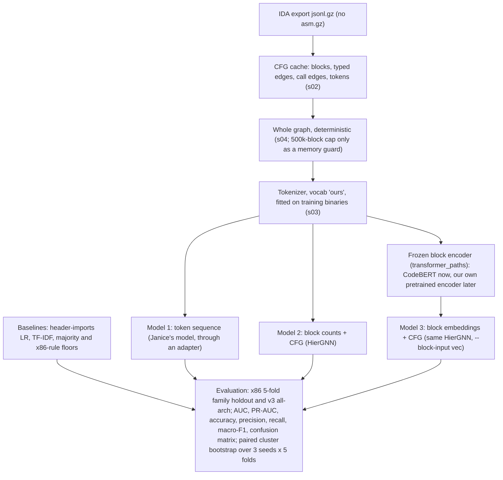

# Review of the `gnn` and `yanping` branch pipelines (2026-10-19)

This page reviews the two GAT pipelines on `origin/gnn` (Dorothy, 331ce0b, which also carries Yanping's
`preprocess_full.py` from `origin/yanping` 3fd99e1 and Janice's AutoTokenizer work), explains what had to change to
compare them with our models, and lists fixes the owners may want to make on their branches. Nothing on those branches
was modified: our adapters in `experiments/team_pipelines/` import the code pinned by sha256 and only feed it sample
lists and collect its outputs.

| Pipeline | Files | Nodes | Model |
|---|---|---|---|
| A, opcode mode | `construct_blocks.py --gnn`, `train_cfg.py` | 57 numbers per block: mnemonic mix, API-group counts, size and degree | 2 GATConv layers, mean pool |
| A, CodeBERT mode | `construct_blocks.py`, `train_cfg.py` | 768-d frozen `microsoft/codebert-base` vector of each block's text | same |
| B | `CT_GAT/preprocessing/preprocess_full.py` (+ `tokenize_asm_gz.py`), `graph_full_loader.py`, `gat_full_model.py`, `train_full_gat.py` | 141 numbers per block: a 64-d pooled five-channel token embedding and 77 counts and rates | 2 GATConv layers with typed edges (edge_dim 8), mean + max pool |

## 1. Where `train.csv` comes from (Janice's error)

`tokenize_asm_gz.py` (line 425) looks for `CT_GAT/data/Mendeley_Ransomware/` and `CT_GAT/data/Mendeley_Goodware/` (the
`gnn` branch moved this to `<repo>/data`) and reads `<folder>/splits/{train,test}.csv` in each. Those folders are the
per-collection zips of the 2026-10-08 Drive upload, `Collections/Mendeley_Ransomware.zip` and
`Collections/Mendeley_Goodware.zip`: each holds `samples.csv`, `splits/{train,test,unassigned}.csv` (with the
`collection` and `asm_path` columns the code reads) and `samples/{train,test}/<family>/<sha256>.{jsonl.gz,asm.gz}`.
`Mendeley_CFG_v1.zip` is the older single bundle (`Mendeley_GNN_v1/`, one shared `splits/` with `excluded.csv`, CFGs only,
no `.asm.gz`), so the path does not exist and the tokenizer would have no listings to read. Unzip both collection zips
into the data folder, or pass both folders with `--root` (repeatable). The sample hashes and CFG files are identical in
both packagings.

## 2. What makes the published numbers incomparable

These apply to both pipelines unless marked.

1. **One fixed split.** Both train and test on Mendeley's original family-disjoint split (24 train / 14 test ransomware
   families). One split with 14 test families has a wide spread; our tables use 5 family-holdout folds and paired
   cluster-bootstrap intervals.
2. **That split is inverted on x64.** Train x64 is 481 goodware / 42 ransomware; test x64 is 12 goodware / 68 ransomware.
   Any feature that tells x64 from x86 learns "x64 means goodware" in training and is wrong on test. Our headline is
   x86-only for this reason.
3. **Validation shares families with training.** `train_cfg.stratified_holdout` (line 41) and
   `graph_full_loader.split_graphs` (line 172) take a random 15% per label. Early stopping and the decision threshold are
   then tuned on families the model has already seen, which is optimistic. Our `carve_validation` holds out whole
   families (and goodware identity groups).
4. **No per-sample predictions.** Neither trainer saves test probabilities by sample, so paired comparisons and AUC
   intervals are impossible. `train_cfg.py` also reports no AUC.

## 3. Pipeline A findings

- **Register names in the CodeBERT text.** `_operand_text` (line 135) writes raw register names (`rax`, `r8`, `eax`),
  decimal immediates and hex addresses into the block text. Under the inverted split (item 2) register names are an
  x64 detector, so the CodeBERT arm can score by architecture. Text is also cut at 128 subword tokens, about the first
  15-25 instructions of a block.
- **`--limit` returns one class.** `load_split_rows` (line 80) sorts by label then id, and `--limit` takes the prefix, so
  the README's `--limit 4` run is goodware only.
- **Stale graphs are reused.** Existing `.pt` files are skipped unless `--overwrite` (lines 657, 733), so a new
  `--max-blocks` silently keeps old graphs; `train_cfg.load_split` (line 27) reads every `.pt` in the folder with no check
  against the split.
- **Failures vanish.** Per-sample exceptions are caught and skipped (lines 705, 753), so the test set can shrink without
  notice.
- Smaller: in-degree and out-degree are undercounted in truncated functions; `je`/`jne` bins are always zero because IDA
  writes `jz`/`jnz`; the `urlmon` key never matches; `inspect_graph.py` defaults to Janice's old `graph_0.pt` naming.
- Janice's `origin/AutoTokenizer` version is fully superseded by this one (merged in 55e709b, rewritten in 3445c0c). Its
  ~30 MB of `.pt` files were removed from the tree in b2b066f but remain in git history.

## 4. Pipeline B findings

- **API vocabulary fitted on train and test.** `--split all` is the default (line 1784) and the vocabulary grows on every
  sample unless `--freeze-vocab` is set (lines 1093-1106). Test-only API names then get their own ids.
- **The "learned" embedding is random and unseeded.** The five-channel embedding is pooled under `no_grad` and never
  trained, and no `torch.manual_seed` is set, so the 64-d half of every node changes between preprocessing runs.
- **Size caps drop mostly ransomware.** The default caps (asm over 200 MB, over 80k blocks or over 450k instructions,
  lines 72-74) skip 89 of 2,434 bundle samples, 82 of them ransomware.
- **Listing-to-CFG alignment fails mostly on ransomware.** Each CFG instruction is matched to a line of the `.asm.gz`
  listing. In the first 511 binaries built for our folds, 68 of 340 ransomware (20%) but only 2 of 171 goodware (1%)
  have under half of their selected instructions matched; the worst families are stop, pysa, playcrypt and gandcrab.
  Unmatched instructions lose their opcode and operand channels, so "missing features" is itself a ransomware signal.
  The likely cause is that the Mendeley listings (`ida_asm_mendeley_20261006`) and CFG exports (2026-10-07) come from
  different IDA runs, which disagree most on packed or obfuscated code; this is a hypothesis, not yet checked.
- **Operand classes depend on architecture.** `_REG_DATA` (line 241) covers `r8`-`r15` and `eax`-`dl` but not `r8d`,
  `xmm*`, `ah`-`dh`, `sil`/`dil` and others, which fall through to `MEM_GLOBAL_REF` (lines 267, 274), so x64 code has
  inflated `MEM_GLOBAL_REF` rates. On x86-only folds this matters less.
- **"signal" sampling is not one connected subgraph.** It ranks whole functions by imports and calls and returns their
  union; the module docstring says connected, and `connected_keys` is unused. `walk` is connected.
- Bugs: `_selected_rows` reads `row["collection"]` (line 1201), which the bundle CSVs lack (KeyError); the CFG path is
  derived from the listing's folder, so the bundle layout (CFGs and listings apart) fails; the vocabulary is saved after
  every sample, including `--limit` runs; a rerun into the same folder with a different `--sample`, `--seed` or budget
  silently mixes old and new graphs (`can_resume`); `train_full_gat.roc_auc` (line 47) returns 0.0 instead of NaN for a
  one-class set.

## 5. How we ran them on our folds

`experiments/team_pipelines/README.md` has the commands. In short, for kfold x86 (1,810 binaries, 5 family-holdout
folds, seeds 0 1 2):

- every arm uses our fold manifests, family-held-out validation, our threshold rule, and writes our predictions format,
  so `stats.py` and `gates.py --stage team` pair it with our models on identical test ids;
- no sample is skipped (size caps off; a failure stops the build);
- A runs as published (opcode mode, 500-block budget, their recipe); for CodeBERT we used the owner's choice of block
  text built from our export's register-free strings (`xor r,r ; kernel32!createfilew`), fed to Dorothy's GAT (`cb500`)
  and to our GNN (paths 1 and 2), instead of the raw-operand text;
- B is preprocessed once with `signal` sampling at 500 blocks and a fixed seed; per fold, API ids unseen in that fold's
  training binaries become UNK and the embedding is re-pooled, so nothing is fitted on test;
- our own GNN also runs at the same 500-block cap (`b500`) so budget is not the difference.

## 6. Results (partial, 2026-10-19)

kfold x86, 1,810 test binaries, AUC checkpoint at its validation threshold; pooled table seed 0, paired differences over
seeds 0 1 2 (TF-IDF: seed 0 only).

| model | AUC | PR-AUC | macro-F1 | accuracy | precision | recall | TP | FN | FP | TN |
|---|---|---|---|---|---|---|---|---|---|---|
| TF-IDF | 0.982 | 0.990 | 0.935 | 0.939 | 0.951 | 0.951 | 1079 | 55 | 55 | 621 |
| header-imports LR | 0.985 | 0.991 | 0.954 | 0.957 | 0.971 | 0.960 | 1089 | 45 | 33 | 643 |
| our typed GNN (R7), whole graph | 0.986 | 0.990 | 0.935 | 0.938 | 0.965 | 0.935 | 1060 | 74 | 38 | 638 |
| A, opcode mode, 500 blocks | 0.956 | 0.975 | 0.850 | 0.854 | 0.939 | 0.820 | 930 | 204 | 60 | 616 |
| A on CodeBERT vectors, 500 blocks | 0.791 | 0.872 | 0.723 | 0.724 | 0.925 | 0.608 | 690 | 444 | 56 | 620 |

Against R7 (3 seeds): A opcode dAUC -0.025 [-0.043, -0.009], dmacro-F1 -0.072 [-0.136, -0.008]; A on CodeBERT vectors
dAUC -0.159 [-0.221, -0.104], dmacro-F1 -0.184 [-0.242, -0.129]. Both lose on ransomware recall, not on false alarms.
Still running: B (`sig500`), our GNN at the same 500-block cap (separates the cap from the model), and our GNN on the
same CodeBERT vectors (paths 1 and 2, separates the vectors from Dorothy's GAT). B will also be reported on the subset
whose selected instructions are at least 90% matched (section 4). Final tables: `RUNS/gates_team.md`,
`RUNS/gates_paths_codebert.md`.

These runs pin the teammate code at `origin/gnn` 331ce0b. Since then `origin/gnn` 22d1230 lets `train_cfg.py` load
`preprocess_full.py` subgraphs with edge attributes, `origin/yanping` 38c38e5 adds single-instruction tokenization to
`tokenize_asm_gz.py`, and the new `origin/TokenSeqModel` (Janice) adds Model 1 (`src/models/token_sequence.py`) in a
`src/` layout. That branch also deletes `CNN-ViT/`, the old `CT_GAT/` files and most of `meetings/`; check before it
is merged anywhere.

## 7. Suggested fixes, in order of impact

1. Hold out validation by family (or reuse a fixed list of validation families) in both trainers.
2. Save per-sample test probabilities (`sample_id, label, prob`) and report AUC.
3. A: build CodeBERT text from operand categories, not raw operands.
4. B: freeze the API vocabulary on training samples (`--split train` first, then `--freeze-vocab` for test); seed or
   train the embedding; turn the size caps off or apply the same exclusions to every model.
5. B: investigate the alignment gaps before trusting B's numbers; log the per-sample match rate.
   Also stream the listing: `read_text_lines` (`preprocess_full.py` line 302) does `handle.read().splitlines()`, which
   holds the whole decompressed listing in memory. Two Mendeley listings are 341 MB compressed but 23 GB and 890 million
   lines uncompressed, 99.9% of them `db`/`dd` data lines for a payload of a few hundred MB, while their code is only
   3.2k-3.7k blocks; they need more than 20 GB of RAM and were excluded from B with that reason. Iterating the gzip handle
   line by line and keeping only instruction lines fixes it; reading `jsonl.gz` alone (section 9) avoids it.
6. A: make `--limit` take a balanced prefix; fail or list per-sample errors; check graphs against the split.

## 8. The team diagram (2026-10-19) against what exists

| Diagram box | Team code | Ours (`3-block-level-counting`) | Evidence and suggestion |
|---|---|---|---|
| `jsonl.gz` → `load_cfg()` | `preprocess_full.py` | `pipeline/s02_build_cfg_cache` | Same input. Keep. |
| `asm.gz` → `parse_asm_instructions()` → match RVA and mnemonic | `tokenize_asm_gz.py`, `preprocess_full.py` | none: every token comes from `jsonl.gz` | **Drop.** The match fails on 20% of ransomware but 1% of goodware (section 4), which makes missing features a label signal. The team's own `ida_feature_readers.py` produces the same operand-role triplet from `jsonl.gz` alone (built for 6,517 of 6,523 exports), and its side arrays aligned with our cache with zero failures. |
| Full CFG | built per sample | the cache (`cfg_edges`, edge kinds, back edges, call edges) | Keep. |
| Randomly select subgraphs | `walk` / `signal` at a block budget | `s04_select_subgraph` (`cap`, `lcc`; whole graph by default) | **Use the whole graph, deterministic.** Every budget we tried lost AUC against the whole graph (cap 20k -0.011, cap 5k -0.016, lcc 20k -0.017, lcc 5k -0.011; none non-inferior), and at 500 blocks both A arms lost more. Random selection also makes a test prediction depend on a seed. Keep a deterministic cap only as a memory guard. |
| `tokenize_selected_blocks()` | five channels: opcode, two operand roles, API id, behaviour | `s03_tokenizer`: `mn`, `sig`, `beh`, `api` | Settled: under the pre-registered 3-seed test the team's operand-role vocabulary tied ours (section "Vocabulary decision", `PLAN_GNN.md`). Either works; fit the API vocabulary on training binaries only. |
| Model 1, token sequence | `origin/TokenSeqModel` `src/models/token_sequence.py` (new) | no sequence model on this branch; TF-IDF over the same tokens is the bag-of-tokens reference | Add to the same folds and report it next to TF-IDF: on this data the earlier graph-transformer sequence arms (mF1 0.906-0.916) stayed below TF-IDF (0.939). |
| Model 2, block features + CFG | `FullBlockGAT` / `BlockGAT` | `s05_block_counting` + `s06`-`s08` GNN (R7) | Running both (section 6). |
| Model 3, block embeddings + CFG | 64-d pooled random embedding (B); CodeBERT (A) | `transformer_paths` path 2: any frozen block encoder, now CodeBERT on register-free text | Running (paths 1 and 2). A trained block encoder is the open slot. |
| (missing) baselines | none | TF-IDF, header-imports LR, majority and x86-rule floors | **Add** to the diagram: every model is read against them. |
| (missing) evaluation | one fixed split, random validation | 5-fold family holdout, family-held-out validation, paired bootstrap | **Add** as the box all three models feed. |

## 9. Target architecture (adopted 2026-10-19)



Removed from the team diagram, with the evidence in section 8: the `asm.gz` input and the RVA/mnemonic match (a
label-correlated alignment failure, and one listing needs more than 20 GB of RAM), and random subgraph selection (every
budget lost to the whole graph). Added: the baselines and evaluation boxes.

Why the baselines box matters: the header-imports LR, which reads only the PE import table, ties our typed GNN on x86
(0.985 vs 0.986 AUC) and on v3 (0.966-0.970 vs 0.965 AUC, paired difference inside the noise), and on v3 it catches more
x64 ransomware (0.91-0.94 recall vs 0.83). The open question is whether any code model adds anything beyond imports; the
`noapi` ablation (block tokens without `dll!function` names, `gates.py --stage noapi`) tests it.

## 10. Model 1 adapter contract (for `origin/TokenSeqModel`)

To put Model 1 in the same tables, it needs to read our folds and write our prediction format; nothing else in
`src/models/token_sequence.py` has to change.

- Input: the block export `RUNS/export/ours_cap0` (`transformer_paths/EXPORT_SCHEMA.md`): per fold, `fold{k}/manifest.json`
  gives train / val / test sample ids (validation already held out by family), and the store gives each binary's blocks
  as token ids in a per-fold vocabulary fitted on that fold's training binaries. Do not build a vocabulary from test
  binaries.
- Training: train on `train`, choose the epoch and the decision threshold on `val` only, never look at `test`.
- Output, per fold and seed, a run directory written with `experiments/team_pipelines/common.write_run`
  (`predictions.csv`, `predictions_auc.csv` with `sample_id, split, label, prob, pred, arch, family, fold`, and
  `metrics.json`), so `stats.py` and `gates.py` pair it with every other model on identical test ids.
- Report seeds 0 1 2 over folds 0-4. The earlier sequence transformers on this data reached macro-F1 0.906-0.916 against
  TF-IDF's 0.939, so compare Model 1 with TF-IDF first.

## 11. Streaming version (main c7899f0)

Note for Yanping on `CT_GAT/pipeline/s02_preprocess/preprocess_full.py` and `tokenize_asm_gz.py` at main c7899f0. We pinned both files by sha256 as a second source next to 331ce0b, built 60 samples again with the same vocabulary and embedder, and rebuilt pipeline B on all 1,810 binaries with it (`build_b.py --source main-c7899f0`). Nothing in her files was edited.

**What the change fixed.** The two listings that needed more than 20 GB of RAM and stopped the first build (`bbbf38de4f40` and `e8a0e80dfc52`, 341 MB compressed, 23 GB and about 890 million lines uncompressed each) now build. Peak resident memory, polled over the process tree, was 0.62 GB for the first (3,999.7 s wall) and 0.60 GB for the second (4,028.6 s wall), against 20.2 GB and a `MemoryError` before. The time is two passes over 890 million lines; ordinary listings are no slower than before (an 18 MB listing took 209 s against 231 s).

**Does it give the same samples?** Not quite. We took 60 binaries of the first build (30 ransomware, 30 goodware, including the 10 lowest-match ones, which all have a match rate of exactly 0), rebuilt them with her version with the first build's vocabulary and embedder frozen, and compared the saved tensors. In all 60 the selected blocks, the edges and the edge attributes are identical (the sampler is untouched). 25 samples are identical in every array; 35 differ, and in each of the 35 her version matches fewer instructions and in none more: 4,268 of their 137,857 instructions (3.1%), up to 12 points of match rate in one sample (`4708750c9a6f`, 1.0000 to 0.8799). The differing arrays are `instruction_matched`, the opcode, operand and behaviour columns of `instruction_ids` (an unmatched instruction gets the unknown-opcode tokens), `block_features` (on average 9 of 500 blocks), and for 15 samples the api column (46 instructions). Mean match rate over the 60: ransomware 0.630 to 0.604, goodware 0.956 to 0.950.

The cause is one thing. `tokenize_asm_gz._note_location` (lines 547-560) takes the label address from the first token of any listing line, so the line `sub_401E80      endp` sets the address back to the start of the function. `align_sampled_blocks` closes the open span at that moment with `end_rva` equal to the function start, which is smaller than the span's own start; `bisect_left` (line 859) then returns an empty slice and the instructions of that span are never paired. Every function that has an inner label loses the code after its last label, which is usually the epilogue. Two examples, both in the listing text and both matched by the first version:

- `4708750c9a6f`, block (26, 14): `loc_4020F5:` followed by `mov eax, [ebp+var_14]`, `mov esp, ebp`, `pop ebp`, `retn`, then `sub_401E80 endp`. First version: 4 instructions matched. Her version: 4 unmatched.
- `1c209b731ecb`, block (13, 429): `loc_4030EE:` followed by `pop edi`, `pop esi`, `pop ebx`, `leave`, `retn 4`, then `sub_4015A0 endp`. First version: 5 matched. Her version: 5 unmatched.

Her version is less correct here: those lines are in the listing at the right address, and the first version pairs them. To check the cause we ran her module with `_note_location` wrapped to ignore `endp` lines (a wrapper in a scratch script, her files untouched): the 35 differing samples then come out identical to the first version in `instruction_matched`, `instruction_ids` and `block_features`. A fix is to leave the address alone on `endp` and `ends` lines, or to ignore a span whose end is not above its start, plus a test with a function that has an inner label before its `endp`. On the first 550 binaries the full rebuild had finished when this was written, the share with less than 90% of the selected instructions matched is 33.8% for ransomware (23.2% in the first build) and 7.2% for goodware (3.3%); the share below 50% is unchanged (19.7% and 1.7%). `experiments/team_pipelines/match_rates.py` prints these tables for any build.

**What is still in her `main()` and what the change added.** Line numbers are in `preprocess_full.py` unless a file is named.

- Vocabulary on train and test: `--split` defaults to `all` (1918) and `--freeze-vocab` is off by default (1956-1959), so the vocabulary grows over every sample (`full_run`, 1970).
- Embedder unseeded: `FiveChannelEmbedder` is created at 1972 and nothing in either file calls `torch.manual_seed`; `--seed` reaches only the sampler (2014), and `expand_api` draws new rows when the vocabulary grows.
- Size caps: the defaults are at 80-82 and the check at 1995-2004, but the caps no longer fire. `tokenize_asm_gz._selected_rows` (1243-1250) stopped copying `asm_bytes`, `num_blocks` and `num_instructions` into the row, so lines 1987-1989 read 0 and `--max-asm-bytes`, `--max-cfg-blocks` and `--max-cfg-instructions` do nothing; they were active in 331ce0b. The two big listings are therefore no longer skipped, by accident.
- CFG path from the listing path: `_cfg_path_for_asm` (1906) is used at 2006; the Mendeley bundle keeps CFGs and listings in different folders, so a missing CFG raises at 2009.
- Failures skipped: `except Exception` (2032-2035) logs, counts `failed` and goes on, and the process exits normally, so the output folder can lack samples without a failing status.
- Vocabulary and embedder saved after every sample: 2027-2028, also for `--limit` and `--sample-id` runs; line 2038 only decides whether to log it.
- `can_resume` (1974) is true when `channel_embedder.pt` exists; an existing `.pt` is then skipped (1990) whatever `--sample`, `--seed`, `--num-blocks` or vocabulary produced it, and the embedder is loaded from the folder.
- `signal` is not connected: `sample_signal_subgraph` (1044) returns the union of the highest-ranked functions and `connected_keys` (1118) is never called, while the module docstring (line 1) says one connected subgraph.
- `_selected_rows` still reads `row["collection"]` (`tokenize_asm_gz.py` 1247), which the bundle CSVs lack.
- New, two full passes over the listing for every sample: `align_sampled_blocks` (1809-1814) and `tokenize_selected_blocks` (1817-1823), whose `collect_ida_imports` (`tokenize_asm_gz.py` 690-720) scans every line again with a regular expression. The memory is fixed but the decompress-and-scan time is doubled; reading the `extrn` lines inside the first pass would halve it.
- New, the `endp` regression above (`_note_location`, and 858-859 and 887-895 in `align_sampled_blocks`). It also makes `mismatch_report` unreliable: the span that follows `endp` is re-anchored at the function start with no code lines, so every selected instruction of the function is reported as `no_asm_line_in_address_span` (884), matched or not. For `4708750c9a6f` `missing_asm_count` is 5,763 of 6,079 selected instructions while 730 were really lost, and for `1c209b731ecb` it is 2,861 of 2,861 while 39 were lost; the lost ones carry the same reason as the matched ones.
- New, `bisect` and unsorted data: `pairable_rvas` (834-835) and `selected_rvas` (836) are sorted, so the bisect calls are valid; what is not monotone is the sequence of label addresses in the listing, and the code does not check it. An end address below the start gives an empty slice without a message (859-860); the same address seen twice processes its function twice (`placed`, 865, only feeds the final report).
- New, the `selected_rvas` filter (896) drops a line only when no selected instruction lies at or above the span's address, so lines of all spans before the last selected instruction are buffered until the next label and discarded at 861-863. The memory is bounded by the largest code span, not by the selected ones; a function with millions of code lines and no inner label would still be held whole.
- New, a selected block whose span is never opened (no label at or below its address, or an address the listing does not have) is left unmatched and reported as `rva_before_any_asm_label` (901-905), the only case that gets that reason. The report keeps 32 examples per kind, so only its counts say how many instructions are affected, and those are inflated by the `endp` case above.
- New, line splitting: `splitlines()` is replaced by iterating the text handle, so form feeds and the other Unicode line boundaries no longer split a line; the 60-sample comparison shows no effect from this.

## 12. Why the match fails, and how to check a fix

Note for Yanping on the listing-to-CFG match in pipeline B. We measured it on the first build (`RUNS/team/b_sig500`, `preprocess_full` of 331ce0b, 1,808 of 1,810 binaries) and replayed 80 single samples through her pinned functions (`load_cfg`, `parse_asm_instructions`, `align_cfg_to_asm`, and `align_sampled_blocks` for the second source), with the example limit of her mismatch report lifted in memory. None of her files was edited and no new listing or CFG parser was written. The tools are `experiments/team_pipelines/match_diagnosis.py` and `match_acceptance.py` (README, "Match diagnosis and acceptance"). All 80 replays reproduce the build's own matched count exactly.

**The finding in one line.** The listings do not contain the code of the functions IDA marked as library functions: each is one line `; [000002BA BYTES: COLLAPSED FUNCTION initialize_pointers(void)]`, and the CFG has all of them. Of the instructions lost in the 80 replayed samples, 99.8% (ransomware) and 96.7% (goodware) belong to such functions; mnemonic disagreements and the other causes below are 0.2% of the ransomware loss and 3.3% of the goodware loss. The label gap exists because ransomware samples are mostly statically linked library code (C runtime, Go runtime, MFC) and the `signal` sampler ranks whole functions by imports and calls, which, in the worst samples, selects functions that are all library functions (this is read off the replayed samples, not measured over the whole build). The earlier hypothesis in section 4, two IDA runs that disagree on packed code, is not what the data show.

Evidence that the listing is the missing side, from the CFG records themselves. Every function record in the `.jsonl.gz` carries `library` and `thunk` flags. For `05e06709523f` (ryuk, 533 functions) 438 functions are `library` and none of them has a `proc` line in the listing, while 94 of the 95 non-library functions do (the 95th is a thunk with a COLLAPSED marker); 371 of the 438 library functions have a COLLAPSED marker under the same name, and the other 67 are neither listed nor matched to a marker by name. Names fail to match when the marker carries the demangled form, as in `48976d7bf38c`, where the CFG's `?initialize_pointers@@YAHXZ` is `initialize_pointers(void)` in the listing; we did not check these 67 one by one. Over the 80 replayed samples the CFG holds 75,015 functions; 29,090 have a label at their entry, the listing has 44,035 collapsed markers, and 1,845 procedures are listed under another spelling of their name (IDA turns `.` into `_`: the Go function `unicode.init` is `unicode_init`). 29,090 + 44,035 + 1,845 = 74,970 of 75,015.

### 12.1 Match rate by label, family and size (1,808 binaries of the first build)

| label | binaries | mean match | below 50% | below 90% | exactly 0 |
|---|---|---|---|---|---|
| ransomware | 1132 | 0.855 | 187 (16.5%) | 238 (21.0%) | 1.7% |
| goodware | 676 | 0.978 | 7 (1.0%) | 23 (3.4%) | 0.0% |

The AUC of `1 - match rate` as a ransomware score is 0.543, with a 95% interval of [0.461, 0.635] from 1,000 resamples of the 712 clusters (one per ransomware family, one per goodware binary, as `evaluation/stats.py` draws them). The point estimate is low because most binaries of both labels sit at or near 1.0 (63% of the ransomware and 67% of the goodware binaries match completely), so the rank statistic is decided in the tails and by ties; the interval is wide and its upper end is above 0.6. The label signal sits in the tail (the 21% against 3.4%), which a rank statistic over all binaries understates. The ten worst families:

| family | binaries | mean match | below 50% | below 90% |
|---|---|---|---|---|
| lorenz | 15 | 0.295 | 100.0% | 100.0% |
| stop | 35 | 0.297 | 82.9% | 82.9% |
| pysa | 38 | 0.314 | 100.0% | 100.0% |
| playcrypt | 43 | 0.574 | 44.2% | 76.7% |
| blackbasta | 26 | 0.586 | 53.8% | 57.7% |
| gandcrab | 49 | 0.599 | 42.9% | 46.9% |
| nefilim | 25 | 0.658 | 36.0% | 44.0% |
| ryuk | 33 | 0.666 | 27.3% | 54.5% |
| mountlocker | 5 | 0.821 | 20.0% | 20.0% |
| karma | 13 | 0.828 | 23.1% | 23.1% |

Fourteen of the 36 ransomware families match at 99% or better on average (netwalker, blackcat, blackmatter, bluesky, darkside, hive, lockbit and others at 1.000), so the effect is a property of the binaries, not of ransomware as such. The goodware pool `goodware` (562) has 3.7% below 90%, the held-out `goodware_test` (114) 1.8%; the full per-family table is in the JSON of `match_diagnosis`.

Lost share by function length (selected instructions of one function, from the saved tensors, all 1,808 binaries):

| label | length | functions | selected | lost | lost share | fully lost functions |
|---|---|---|---|---|---|---|
| ransomware | 1-9 | 5927 | 9542 | 3773 | 39.5% | 3597 |
| ransomware | 10-49 | 2669 | 73160 | 3564 | 4.9% | 137 |
| ransomware | 50-199 | 8053 | 947354 | 118465 | 12.5% | 996 |
| ransomware | 200-999 | 6111 | 2324397 | 235015 | 10.1% | 523 |
| ransomware | 1000+ | 842 | 2458802 | 126542 | 5.1% | 76 |
| goodware | 1-9 | 1513 | 3727 | 1389 | 37.3% | 923 |
| goodware | 10-49 | 2394 | 61152 | 4000 | 6.5% | 210 |
| goodware | 50-199 | 3934 | 424878 | 13950 | 3.3% | 84 |
| goodware | 200-999 | 1921 | 732057 | 9015 | 1.2% | 17 |
| goodware | 1000+ | 321 | 646549 | 2232 | 0.3% | 2 |

Functions of 1 to 9 instructions are lost most often in both labels (37-40%); the label gap is in the long functions, where ransomware loses 5-12% against 0.3-3%. In the replay, where the label spans (CFG instructions between two listing labels) are known:

| span length | spans | selected | lost | lost share |
|---|---|---|---|---|
| 1-9 | 5123 | 19872 | 139 | 0.7% |
| 10-49 | 2605 | 50731 | 955 | 1.9% |
| 50-199 | 313 | 24231 | 3100 | 12.8% |
| 200-999 | 137 | 33298 | 17625 | 52.9% |
| 1000+ | 143 | 96439 | 91553 | 94.9% |

A span of a few instructions is a function that has a label and a listing; a span of 200 or more is a label followed by collapsed functions that have none, so the CFG rows of all of them are bucketed under the last label before them and nothing is left to pair with.

### 12.2 What the unmatched instructions are

The gap reports in the manifests (counts only; the report keeps 32 examples per kind) summed over the first build. Scope: for 331ce0b the alignment covers the whole CFG, so the columns count every CFG instruction, not only the selected ones; for the second source they count selected instructions and are inflated by the `endp` reset (section 11).

| label | manifests | selected instr. | CFG instr. without listing line | listing lines without CFG instr. | duplicate RVAs | address problems |
|---|---|---|---|---|---|---|
| ransomware | 1132 | 5813255 | 18876058 | 3784738 | 185915 | 1 |
| goodware | 676 | 1868363 | 1188764 | 592594 | 21441 | 1 |

Reasons of the retained examples: ransomware `collapsed_function` 16,785, `no_asm_line_in_address_span` 7,424, `rva_before_any_asm_label` 804; goodware `collapsed_function` 12,976, `no_asm_line_in_address_span` 2,981. Her `collapsed_function` test is a substring match of the CFG name in the marker, so it misses every function whose marker is demangled; those fall under `no_asm_line_in_address_span`.

The replay sorts every unmatched selected instruction of 80 samples into one cause. The samples are the 30 lowest-match samples, the 10 lowest-match goodware samples, and 20 random samples per label that lose some but not all (seed 0). Counts are instructions.

| cause | ransomware | goodware |
|---|---|---|
| (i) listing label missing below the RVA | 0 | 1 |
| (ii) lost after a mnemonic disagreement | 0 | 23 |
| (iii) function without listing lines | 100024 | 13289 |
| (iv) duplicate RVA (skipped on purpose by the pairing) | 217 | 408 |
| (v) a label kind her address rule does not read | 21 | 15 |
| (vi) `endp` reset | 0 | 0 |
| (vii) other | 0 | 0 |
| selected instructions replayed | 157795 | 67402 |
| unmatched | 100262 | 13736 |

Cause (iii) splits into the function being a COLLAPSED FUNCTION under the CFG's own name (ransomware 69,190, goodware 11,874) and the function having no label at its entry while its marker could not be matched by name (ransomware 30,834, goodware 1,415); the second group is the demangled and sanitised names above, counted by the label census (the unlabelled functions equal the collapsed markers to within 0.1%). Code labels without an address (`def_`, `nullsub_`, `j_` and other names) number 20,093 `named`, 141 `def_` and 86 `j_` over the 80 listings; only 36 instructions (cause v) were lost after a disagreement in a span that holds one. No listing line without a label address occurred (`lines_without_label` 0 in all 80). (vi) is zero because these are first-source builds; section 11 and 12.4 cover the second source.

Mnemonic disagreements: the first disagreement of a label span, as (listing, CFG) pair, with the instructions lost after it. There are five in the 80 samples, and none is a prefix, a `retn`/`ret` spelling, a filler or data printed as code.

| pair (listing, CFG) | spans | lost |
|---|---|---|
| mov, retn | 3 | 21 |
| lea, push | 1 | 16 |
| mov, jmp | 1 | 14 |
| call, push | 1 | 7 |
| jmp, call | 1 | 1 |

### 12.3 The ten worst samples

Ten lowest-match samples of distinct (family, selected instructions) pairs; several others are copies of the same binary (seven ryuk binaries have the same 2,499 selected instructions and all lose them). `selected`, `matched` and the listing census are from the replay. Each excerpt is at most 8 lines of her listing file for the first function with an unmatched selected instruction that has a marker.

| sample | family | match | selected | CFG functions | with a label | collapsed markers |
|---|---|---|---|---|---|---|
| `9e6be0a3bf10` | nefilim | 0.000 | 4587 | 2584 | 1 | 2318 |
| `148845af1fc1` | nefilim | 0.000 | 4135 | 2539 | 1 | 2245 |
| `f0aec57001a1` | phobos | 0.000 | 3065 | 3639 | 413 | 3225 |
| `05e06709523f` | ryuk | 0.000 | 2839 | 533 | 94 | 439 |
| `2ec5256a7edb` | ryuk | 0.000 | 2499 | 421 | 69 | 352 |
| `d236d64b7bf9` | conti | 0.000 | 2402 | 1438 | 303 | 1136 |
| `48976d7bf38c` | blackbasta | 0.000 | 2271 | 2151 | 866 | 1281 |
| `1fe9b489c25b` | revil | 0.049 | 2537 | 387 | 54 | 333 |
| `dc6b0e8c1e9c` | revil | 0.050 | 2463 | 391 | 54 | 337 |
| `54ac8cbce477` | goodware | 0.058 | 2213 | 173 | 13 | 160 |

`9e6be0a3bf10` (Go; the function is `unicode.init`, 4,587 selected instructions):

```
                align 10h
; [000000E1 BYTES: COLLAPSED FUNCTION unicode_isExcludingLatin]
                align 10h
; [0000551A BYTES: COLLAPSED FUNCTION unicode_init]
                align 10h
; [000001E5 BYTES: COLLAPSED FUNCTION reflect_makeMethodValue]
                align 10h
; [00000062 BYTES: COLLAPSED FUNCTION reflect_name_tagLen]
```

`148845af1fc1` (Go; the same function, 4,135 selected instructions):

```
                align 10h
; [000000CF BYTES: COLLAPSED FUNCTION unicode_isExcludingLatin]
                align 10h
; [00004EE8 BYTES: COLLAPSED FUNCTION unicode_init]
                align 10h
; [000001BC BYTES: COLLAPSED FUNCTION reflect_makeMethodValue]
                align 10h
; [00000065 BYTES: COLLAPSED FUNCTION reflect_name_tagLen]
```

`f0aec57001a1` (`@SysUtils@_16771` and its neighbours):

```
; [000000BC BYTES: COLLAPSED FUNCTION unknown_libname_421]
; [00000049 BYTES: COLLAPSED FUNCTION unknown_libname_422]
                align 4
; [00000661 BYTES: COLLAPSED FUNCTION unknown_libname_423]
                align 4
; [00000061 BYTES: COLLAPSED FUNCTION Graphics::CopyPalette(uint)]
                align 4
; [0000020C BYTES: COLLAPSED FUNCTION unknown_libname_424]
```

`05e06709523f` (`__input_l`, 5,786 bytes of C runtime):

```
                align 10h
; [0000005F BYTES: COLLAPSED FUNCTION _ValidateLocalCookies]
                align 10h
; [0000169A BYTES: COLLAPSED FUNCTION __input_l]
                align 4
jpt_35007A2C    dd offset loc_35007BA2  ; DATA XREF: __input_l+42C↑r
                dd offset loc_35007A33  ; jump table for switch statement
                dd offset loc_35007A54
```

`2ec5256a7edb` (`___security_init_cookie`):

```
; [00000028 BYTES: COLLAPSED FUNCTION ___scrt_uninitialize_crt]
; [0000003B BYTES: COLLAPSED FUNCTION __onexit]
; [00000015 BYTES: COLLAPSED FUNCTION _atexit]
; [0000009C BYTES: COLLAPSED FUNCTION ___security_init_cookie]

; =============== S U B R O U T I N E =======================================

```

`d236d64b7bf9` (MFC; `unknown_libname_56`, after the last listed function `sub_408CAA`):

```
sub_408CAA      endp

; [0000007E BYTES: COLLAPSED FUNCTION CWnd::PrepareForHelp(void)]
; [000005C2 BYTES: COLLAPSED FUNCTION unknown_libname_56]
                db 8Bh, 0FFh
jpt_408FBA      dd offset loc_40903D, offset loc_40904F, offset loc_40904F
                                        ; DATA XREF: unknown_libname_56+1B3↑r
                dd offset loc_40904F, offset loc_409069, offset loc_409085 ; jump table for switch statement
```

`48976d7bf38c` (the CFG name is the mangled `?initialize_pointers@@YAHXZ`; the marker carries the demangled name):

```
; [00000027 BYTES: COLLAPSED FUNCTION __Xtime_get_ticks]
; [00000055 BYTES: COLLAPSED FUNCTION _xtime_get]
; [0000001F BYTES: COLLAPSED FUNCTION __Cnd_broadcast]
; [000002BA BYTES: COLLAPSED FUNCTION initialize_pointers(void)]
; [00000026 BYTES: COLLAPSED FUNCTION ___crtGetSystemTimePreciseAsFileTime]
; [0000001A BYTES: COLLAPSED FUNCTION unknown_libname_34]
; [00000063 BYTES: COLLAPSED FUNCTION _Init_atexit::~_Init_atexit(void)]
                db 5 dup(0CCh)
```

`1fe9b489c25b` (`___scrt_fastfail`):

```
                retn
sub_4017E5      endp

; [0000011B BYTES: COLLAPSED FUNCTION ___scrt_fastfail]
; [00000033 BYTES: COLLAPSED FUNCTION ___scrt_get_show_window_mode]
; [00000044 BYTES: COLLAPSED FUNCTION ___scrt_is_managed_app]

; =============== S U B R O U T I N E =======================================
```

`dc6b0e8c1e9c` (revil, `___scrt_fastfail` again, another build of the same program):

```
                retn
sub_401846      endp

; [0000011A BYTES: COLLAPSED FUNCTION ___scrt_fastfail]
; [00000031 BYTES: COLLAPSED FUNCTION ___scrt_get_show_window_mode]
; [00000005 BYTES: COLLAPSED FUNCTION j_UserMathErrorFunction]
; [00000043 BYTES: COLLAPSED FUNCTION ___scrt_is_managed_app]
```

`54ac8cbce477` (goodware, `___tmainCRTStartup`; 13 of 173 functions have a listing):

```
                pop     ecx
                pop     ebp
                retn
; [0000017E BYTES: COLLAPSED FUNCTION ___tmainCRTStartup]
; [0000000A BYTES: COLLAPSED FUNCTION start]
; [00000042 BYTES: COLLAPSED FUNCTION __CxxUnhandledExceptionFilter(_EXCEPTION_POINTERS *)]

; =============== S U B R O U T I N E =======================================
```

### 12.4 The second source (main c7899f0) on the partial rebuild

The rebuild with her streaming `preprocess_full` is not finished: the checkpoint of `RUNS/team/b_sig500_v2` held 1,350 of 1,810 ids when this was measured and there is no `build_summary.json` yet, so criterion 1 cannot pass and everything below is for those 1,350 ids, next to the same 1,350 ids of the first build. To redo it on the finished build, run the two commands of 12.6 on `RUNS/team/b_sig500_v2` once `build_summary.json` reports 1,810 processed.

| on the same 1,350 ids | first source (331ce0b) | second source (c7899f0) |
|---|---|---|
| ransomware mean match | 0.850 | 0.809 |
| ransomware below 90% | 186 of 853 (21.8%) | 289 of 853 (33.9%) |
| ransomware below 50% | 145 of 853 (17.0%) | 147 of 853 (17.2%) |
| goodware mean match | 0.977 | 0.964 |
| goodware below 90% | 18 of 497 (3.6%) | 36 of 497 (7.2%) |
| goodware below 50% | 6 of 497 (1.2%) | 6 of 497 (1.2%) |
| AUC of 1 - match rate | 0.547, interval [0.462, 0.634] | 0.754, interval [0.666, 0.832] |

The `endp` reset of section 11 shows up as a leak of its own: it moves instructions from "matched" to "unmatched" mostly in ransomware, which raises the AUC from 0.547 to 0.754 and the ransomware below-90% share by 12 points, while the below-50% tail is unchanged (the collapsed functions, which it does not touch). The replay of 50 samples of the second build (15 lowest-match, 5 lowest-match goodware, 15 random lossy samples per label; all 50 reproduce the build's matched count) classifies cause (vi) as instructions that the first source's alignment pairs and the second source's does not:

| cause | ransomware | goodware |
|---|---|---|
| (i) listing label missing below the RVA | 0 | 0 |
| (ii) lost after a mnemonic disagreement | 0 | 44 |
| (iii) function without listing lines | 46672 | 9207 |
| (iv) duplicate RVA | 152 | 448 |
| (v) a label kind her address rule does not read | 0 | 0 |
| (vi) `endp` reset | 7428 | 1037 |
| (vii) other | 0 | 1 |
| selected instructions replayed | 126147 | 52538 |
| unmatched | 54252 | 10737 |

So in the second build the collapsed functions still dominate the loss (86% of the ransomware and 86% of the goodware instructions lost), and the `endp` reset adds 14% and 10% on top. Both have to go: option 1 of 12.5 removes them together, option 3(a) removes only the second.

### 12.5 Fix options, ranked

1. **Take the per-instruction fields from the `.jsonl.gz`** and make the listing optional. Each instruction record has `rva`, `size`, `mnemonic`, the structured `operands` (`category` register / phrase / immediate / code_target, `register`, `immediate`, `target_rva`), `is_call`, `import_ids`, `call_resolution`, `code_refs` and `data_refs`; each function record has `library` and `thunk`. The opcode and operand-class channels, the call and import channels and the API channel (through `import_ids` and `call_resolution`) can be built from these without the listing. This removes causes (i) to (vii) for every instruction in one step, makes the match rate 100% by construction, needs no 23 GB listing in memory, and takes away the ransomware-only tail that makes `1 - match rate` a label feature. What it costs: the operand classes come from the structured operand (`MEM_STACK_REF` needs the base register, `MEM_GLOBAL_REF` the absence of one), so the token ids differ slightly from the ones built from listing text; sig500 must be rerun and compared with sig500v3. Where the listing is kept (comments with API names for `call eax`), pairing becomes optional enrichment, and its match rate should be logged and not used as a gate.
2. **Re-export the listings so that library functions are expanded and every line carries its address.** With the bodies of the collapsed functions in the file, causes (iii) and (iv) disappear and pairing could use addresses instead of order. It depends on a new export of the listings, and the two largest listings (23 GB each) get larger when expanded; the CFG already has everything that is missing, so this is a longer route to the same result as 1.
3. **Harden the pairing**, which is worth doing whichever of 1 or 2 is chosen, but fixes little alone. (a) The `endp` reset: leave the label address alone on `endp` and `ends` lines, or ignore a span whose end is not above its start (section 11). (b) Treat a function without listing lines as a known case: do not pair it, give its instructions the CFG-derived tokens of option 1 and not the unknown-opcode tokens, and do not count it as unmatched. (c) Read `library` from the function record to decide this, not the substring test on the marker name (which misses demangled and sanitised names). (d) Match procedure names after the same sanitising IDA applies (`.` and other non-identifier characters become `_`), so `unicode.init` finds `unicode_init proc near`. (e) After a mnemonic disagreement, re-anchor at the next listing label and keep pairing, instead of dropping the rest of the span. (f) Make the build fail a sample, or at least print it, when the match rate is under 90%, and count duplicate RVAs separately from losses (they are skipped on purpose, 408 goodware instructions in the replay).

### 12.6 How to check a fix

Run `match_acceptance.py` on her rebuilt output (a directory with the `<id>.pt`, `<id>.manifest.json`, `checkpoint.json`, `settings.json` and `build_summary.json` that `build_b.py` writes, or the same layout from her own script):

```
python -m experiments.team_pipelines.match_acceptance --build <her new dir>
python -m experiments.team_pipelines.match_diagnosis  --build <her new dir> --cache gaps.json --json diag.json
```

It prints PASS or FAIL for five criteria and exits with status 0 only if all pass: (1) all 1,810 kfold-x86 ids built, none excluded; (2) the share of binaries with under 90% of their selected instructions matched within 2 points between ransomware and goodware; (3) the share under 50% below 1% for both labels; (4) the AUC of `1 - match rate` below 0.55; (5) a deterministic rebuild of 5 sampled ids, tensor for tensor (`torch.equal`), starting from the build's own vocabulary and embedder (`build_b --frozen-from`), because a fresh vocabulary numbers API names differently. The peak-RSS and sig500v3 criteria of the plan are not tested by the script; `measure_rss.py` and `gates.py --stage team` do those. With option 1 criteria 2 to 4 pass by construction and the script then checks mostly criteria 1 and 5. A partial build is evaluated on the ids it holds and marked partial.

Current verdicts: first build, FAIL (criteria 1, 2 and 3 fail; criterion 4 passes at 0.543, interval [0.461, 0.635]; criterion 5 passes, 5 of 5 sampled ids rebuild identically with the frozen vocabulary). Second build, partial (1,350 of 1,810 ids): FAIL (1 of 5 pass): criterion 1 fails (460 ids missing), criterion 2 fails (33.9% against 7.2%, a gap of 26.6 points), criterion 3 fails (17.2% and 1.2%), criterion 4 fails (0.754, interval [0.666, 0.832]), criterion 5 passes (5 of 5 sampled ids rebuild identically with the frozen vocabulary). Both are expected to fail until the fix lands.
