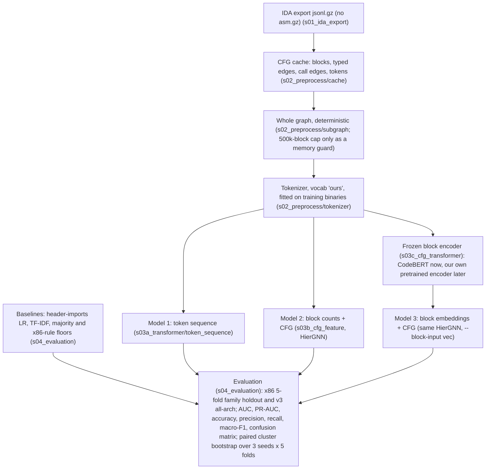

# CT_GAT/pipeline

The ransomware classifiers of this project, from the IDA export of a binary to the tables that compare them. Everything runs
from this folder (`CT_GAT/pipeline`) as `python -m <package>.<module>`; the tests are in `tests/`.

## The pipeline



This is the target architecture adopted on 2026-10-19 ([`docs/history/TEAM_PIPELINES_REVIEW.md`](docs/history/TEAM_PIPELINES_REVIEW.md),
section 9). It drops the `asm.gz` input and the RVA / mnemonic match of the first team diagram (a label-correlated alignment
failure, section 8 of the review) and random subgraph selection (every budget lost to the whole graph), and adds the baselines
and the evaluation boxes.

## The stage folders

| folder | holds | README |
|---|---|---|
| `s01_ida_export/` | the IDAPython extractor that writes the `*.jsonl.gz` CFG export and the `*.asm.gz` listing of a binary (runs inside IDA, on the VM) | [`s01_ida_export/README.md`](s01_ida_export/README.md) |
| `s02_preprocess/` | the team's two preprocessing scripts for the transformer (flat scripts), and the jsonl-only path: `cache/` (CFG cache builder and checker, fold CSVs), `tokenizer/`, `subgraph.py` | [`s02_preprocess/README.md`](s02_preprocess/README.md) |
| `s03a_transformer/` | Model 1, the token-sequence transformer (`token_sequence/`), and Janice Park's five-channel Model 1 (`five_channel/`) | [`s03a_transformer/README.md`](s03a_transformer/README.md) |
| `s03b_cfg_feature/` | Model 2, the hierarchical edge-typed GNN over the block CFG and the call graph (`gnn/`) | [`s03b_cfg_feature/README.md`](s03b_cfg_feature/README.md) |
| `s03c_cfg_transformer/` | Model 3: block export, encoder contract, CodeBERT and reference encoders, precomputed block vectors | [`s03c_cfg_transformer/README.md`](s03c_cfg_transformer/README.md) |
| `s04_evaluation/` | metrics, validation thresholds, the baselines, the paired bootstrap, `report.py` and the gate summaries | [`s04_evaluation/README.md`](s04_evaluation/README.md) |
| `common/` | `RunConfig` (the options of a run and its name), `paths.py` (where the data lives), `manifests.py` (folds), the model registry, `run_io.py` (the run directory every model writes), `reader.py`, `side_io.py` | |
| `experiments/` | `train.py` (the one training command), `queue.py` and `plans/` (the experiments we ran), `stages/` (the gate definitions), `team_pipelines/` (the teammates' GAT pipelines under our folds), `side_arrays/` | [`experiments/team_pipelines/README.md`](experiments/team_pipelines/README.md) |
| `docs/` | [`ADDING_AN_EXPERIMENT.md`](docs/ADDING_AN_EXPERIMENT.md), and `history/`: the plan, the results, the review, the literature review and the final gate tables | [`docs/history/README.md`](docs/history/README.md) |
| `tests/` | the test suite (`pytest.ini` has the markers) | |

## Setup

Python 3.12 and the packages of [`requirements.txt`](requirements.txt) (`pip install --extra-index-url https://download.pytorch.org/whl/cpu
-r requirements.txt` for a CPU machine; install the CUDA build of torch for training). `torch_geometric` is optional: only the
team adapters in `experiments/team_pipelines` use it, and their tests skip without it.

Where the data lives is set per machine, never in the code:

* **`datasets.json`** (gitignored; copy [`datasets.json.example`](datasets.json.example) and edit): `name -> {cache, protocols, sources}`.
  `cache` is the folder that `s02_preprocess.cache.build_cache` writes; `protocols` are the `--protocol` values that read it by
  default; `sources` are the raw inputs a cache is built from and the run directory. A relative path is relative to the file.
  `--cache <name>` picks a dataset, `GT_DATASETS` names another file. `common/paths.py` has the resolution order.
* **`GT_CACHE`** (a folder) beats the registry; **`GT_RUNS`** the run directories (default `runs/` here, gitignored);
  **`GT_EXPORT`** the block exports (default `<runs>/export`).
* **`GT_BUNDLE`, `GT_COLLECTIONS`, `GT_FOLDS`, `GT_FOLDS_V3`, `GT_READER_ROOT`**: the raw inputs of `sources`, each overriding the file.
* **`GT_TEAM_B_BUILD`** (`sources` key `team_b_build`): the pipeline-B build folder of `<sample_id>.pt` files that `--model fivechannel` reads (`--build` beats it).
* **`HF_HOME`** the Hugging Face home that holds `microsoft/codebert-base` (the CodeBERT encoder loads it offline).
* **`GT_PY`** the interpreter of `experiments.queue`; **`GT_TEAM_GNN_ROOT`, `GT_TEAM_MAIN_ROOT`, `GT_TEAM_ASM_DIR`** the pinned
  teammate worktrees and the listing folder of `experiments/team_pipelines`.

## On-disk layout

```
<cache>/                          the CFG cache (GT_CACHE, or the dataset of datasets.json)
    samples/<sample_id>.npz       one binary: token ids, block and function pointers, CFG and call edges, edge kinds
    index.csv  vocab.json         one row per binary (label, arch, family, folds); the global token vocabularies
    side/imports/  side/yanping/  per-binary side arrays (header imports; the team's operand-role ids)
    side/blockvec/<export>_<encoder>/fold<k>/{keys.npy,vectors.npy,meta.json}      frozen block vectors (stage 3c)
<runs>/                           GT_RUNS
    <RunConfig.name>/             one run: config.json manifest.json vocab.json history.csv val_probs.csv best.pt best_auc.pt
                                  predictions.csv predictions_auc.csv metrics.json
    baselines/<dir>/              the TF-IDF / import baselines: metrics.json predictions.csv [stack_logits.csv]
    export/<name>/                a block export: store/ and fold<k>/ (s03c_cfg_transformer/EXPORT_SCHEMA.md)
    encoders/<name>/fold<k>/best.pt     encoder checkpoints (s03c_cfg_transformer/TRANSFORMER_CONTRACT.md)
    gates_<stage>.md  RESULTS.md  val_threshold.md  subgraph_chain.json         the tables
    logs/  STOP                   the queue's per-line logs and its stop file
```

A run is named by its options (`RunConfig.name`, e.g. `kfold0_x86_gnn-mblk15_s0`: protocol and fold, architecture, model and
the options that differ from the defaults, seed). The name is how the gates find the arms, so it never changes for an existing
option (`tests/test_run_names.py` holds 971 recorded names).

## Running

```bash
cd CT_GAT/pipeline
python -m experiments.train --protocol kfold --fold 0 --model gnn --mask-blocks 0.15           # one run (CUDA)
python -m experiments.queue --plan experiments/plans/v3.txt --budget-min 600                   # a whole experiment
python -m s04_evaluation.report                                                                # RESULTS.md of the runs
python -m s04_evaluation.gates --stage v3                                                      # a gate summary
python -m pytest -m "not real_data and not gpu"                                                # the tests, on any machine
```

`experiments/queue.py` runs a plan file of `train`, `baselines`, `report`, `val_threshold` and `gates` lines; a finished run is
skipped, `python -m experiments.queue --stop` stops it between lines, a failed line is retried once, and `--dry` prints what
would run. `experiments/plans/` holds the experiments we ran, one file each (`day1`, `day1b`, `v3`, `subgraph`, `paths`,
`paths_codebert`, `vocab`, `imports`, `imports_header`, `noapi`, `team`, `model1`, `l2_nocall_seeds`, `r2_noapi`; `model1_variants` is written and not yet run); the first lines
of a plan name the CPU steps to run once before it. [`docs/ADDING_AN_EXPERIMENT.md`](docs/ADDING_AN_EXPERIMENT.md) shows how
to add a model, an encoder, a dataset, a control, a plan and a gates stage, and how to read the tables.

## Results

Evaluation: 5-fold family holdout on 1,810 x86 binaries (712 clusters: ransomware families and single goodware binaries), seeds
0 1 2, and a 5,652-binary all-architecture protocol (`kfold_v3`, seed 0); the metrics are AUC, PR-AUC and macro-F1 at the
validation threshold, and differences are paired cluster bootstraps with a pre-registered rule (dAUC >= 0.01 and dmacro-F1 >=
0.02, both intervals above zero).

* The signal is in the tokens and the imports, not in the graph. A bag of blocks over instruction tokens with no edges and no API
  names (R2 noapi) scores AUC 0.981 over 3 seeds, level with the import-table logistic regression (0.985) and with TF-IDF (0.982).
* CFG structure adds nothing the rule accepts: typed edges against no edges is +0.004 AUC [-0.001, +0.010], and shuffled edges
  are worse than none (-0.012).
* A logistic regression on the PE import table ties the typed GNN on x86 (0.985 against 0.986) and on the all-architecture pool
  (0.966 against 0.965), and giving the imports to the GNN adds nothing.
* A third CFG layer, call-graph message passing, CodeBERT block vectors (Model 3, -0.025 AUC against token counts), the
  token-sequence transformer (Model 1) and the teammates' GATs are all level with or below the no-edge bag of blocks.
* The 500-block cap of the teammates' pipelines costs our own GNN 0.021 to 0.063 AUC.

The tables and their derivation: [`docs/history/RESULTS.md`](docs/history/RESULTS.md) (every run), the "Final results" section of
[`docs/history/PLAN_GNN.md`](docs/history/PLAN_GNN.md), the team-pipeline comparison in
[`docs/history/TEAM_PIPELINES_REVIEW.md`](docs/history/TEAM_PIPELINES_REVIEW.md), the literature behind each design choice in
[`docs/history/LITERATURE_REVIEW.md`](docs/history/LITERATURE_REVIEW.md), and the final gate summaries
([noapi](docs/history/gates_noapi.md), [team](docs/history/gates_team.md), [v3](docs/history/gates_v3.md),
[paths_codebert](docs/history/gates_paths_codebert.md), [model1](docs/history/gates_model1.md),
[imports](docs/history/gates_imports_header.md), [subgraph](docs/history/gates_subgraph.md)).
