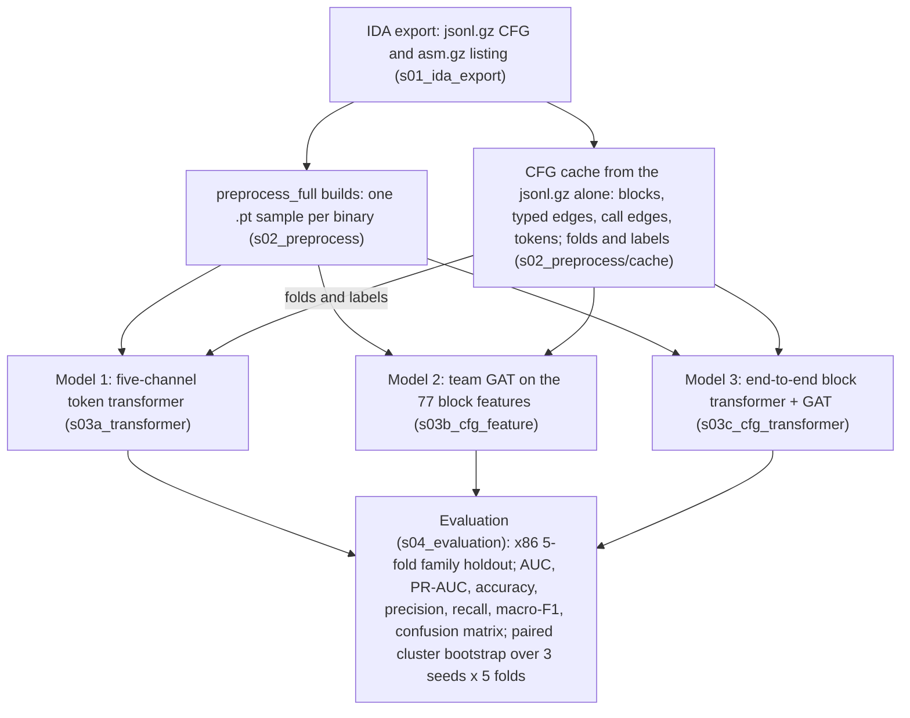

# CT_GAT/pipeline

The ransomware classifiers of this project, from the IDA export of a binary to the tables that compare them. Everything runs
from this folder (`CT_GAT/pipeline`) as `python -m <package>.<module>`; the tests are in `tests/`. The root
[`README.md`](../../README.md) is the short run guide.

## Pipeline


The diagram above is the team's plan; the one below is the code as it stands.



The main path is the three models of the team over the preprocessed `.pt` builds. The CFG cache, built from the `.jsonl.gz`
exports alone, holds the folds and labels every model trains under ([`docs/history/TEAM_PIPELINES_REVIEW.md`](docs/history/TEAM_PIPELINES_REVIEW.md),
section 9): it drops the `asm.gz` input and the RVA / mnemonic match of the first team diagram (a label-correlated alignment failure,
section 8 of the review). The earlier jsonl-only models and the TF-IDF and import-table baselines, with their commands, are on the
branch `jsonl-reference-models`; their results are in `docs/history/`.

## Stage folders

| stage | folder | holds | README |
|---|---|---|---|
| 1. IDA export | `s01_ida_export/` | the IDAPython extractor that writes the `*.jsonl.gz` CFG export and the `*.asm.gz` listing of a binary (runs inside IDA, on the VM) | [`s01_ida_export/README.md`](s01_ida_export/README.md) |
| 2. Preprocessing | `s02_preprocess/` | two routes. `preprocess_full.py` and `tokenize_asm_gz.py` (flat scripts) select blocks from the CFG, align their instructions with the listing and write one `.pt` sample per binary: five-channel token rows, 77 block features, 64-d block embeddings, edges. `cache/` reads only the `.jsonl.gz` exports: the CFG cache builder and checker, and the fold CSVs | [`s02_preprocess/README.md`](s02_preprocess/README.md) |
| 3a. Model 1 | `s03a_transformer/` | Janice Park's five-channel transformer over the instruction sequence (`five_channel/`), on the `.pt` samples | [`s03a_transformer/README.md`](s03a_transformer/README.md) |
| 3b. Model 2 | `s03b_cfg_feature/` | the team GAT on the 77 block features | [`s03b_cfg_feature/README.md`](s03b_cfg_feature/README.md) |
| 3c. Model 3 | `s03c_cfg_transformer/` | the block transformer trained end to end under the GAT | [`s03c_cfg_transformer/README.md`](s03c_cfg_transformer/README.md) |
| 4. Evaluation | `s04_evaluation/` | metrics, validation thresholds, the paired bootstrap, `report.py` and the gate summaries | [`s04_evaluation/README.md`](s04_evaluation/README.md) |
| | `common/` | `RunConfig` (the options of a run and its name), `paths.py` (where the data lives), `catalog.py` (the datasets), `manifests.py` (folds), the model registry, `run_io.py` (the run directory every model writes) | |
| | `experiments/` | `train.py` (the training command of Model 1), `queue.py` and `plans/` (`model1_variants`, `team_b`, `team_builds`), `stages/` (the gate definitions `model1_variants` and `team`), `team_pipelines/` (the GAT trainers of Models 2 and 3 under our folds, `build_b.py` and `package_build.py`, which zips a finished build) | [`experiments/team_pipelines/README.md`](experiments/team_pipelines/README.md) |
| | `docs/` | [`ADDING_AN_EXPERIMENT.md`](docs/ADDING_AN_EXPERIMENT.md), and `history/`: the plan, the results, the review, the literature review and the final gate tables | [`docs/history/README.md`](docs/history/README.md) |
| | `tests/` | the test suite (`pytest.ini` has the markers) | |

Labels are binary. The behaviour tags of the five-channel tokens (encrypt, file read, ...) describe what an instruction does, and
models can use them to point at suspicious regions.

## Repository layout

```
README.md                         how to run the code
meetings/                         team and advisor meeting notes
.github/workflows/                CI: the pipeline tests on every push and pull request
CT_GAT/
    data/                         the unzipped collections (gitignored)
    cache/                        the CFG caches the pipeline builds, one folder per dataset: CT_GAT/cache/<dataset> (gitignored)
    processed/                    the preprocessed .pt samples: the unzipped zips, or the output of preprocess_full.py or build_b (gitignored)
    pipeline/                     all the code; this README
        s01_ida_export/  s02_preprocess/  s03a_transformer/  s03b_cfg_feature/  s03c_cfg_transformer/  s04_evaluation/
        s02_preprocess/folds/     the committed fold assignments of every published result
        common/  experiments/  docs/  tests/
        requirements.txt  datasets.json.example
```

## Setup

Python 3.12 and the packages of [`requirements.txt`](requirements.txt), which adds the CPU wheel index of PyTorch:

```bash
pip install -r requirements.txt
```

For training on a GPU, install the CUDA build of torch 2.11.0 from https://pytorch.org first (`requirements.txt` pins that version and would replace another). `requirements.txt` also lists the optional
packages (`psutil`, `transformers`) and what needs them. `torch_geometric` (pinned there) is used by the Model 2 and 3 trainer in
`experiments/team_pipelines` and by `s03b_cfg_feature/gat`; they import it when they run, and their tests skip without it.

Every input has a default location, so a machine that unzips the two Mendeley collections into `CT_GAT/data/` needs no
configuration file and no environment variable. The datasets are rows of [`common/catalog.py`](common/catalog.py), which
computes every root from its own location and holds no machine path:

| what | default | set elsewhere with (see Overrides) |
|---|---|---|
| collections | `CT_GAT/data/<Collection>/`, a folder with `samples.csv` and `summary.json`, as the Drive zips unpack | `GT_COLLECTIONS` |
| Mendeley bundle | none; `CT_GAT/data/Mendeley_GNN_v1/` is used when it is there | `GT_BUNDLE` |
| fold assignments | `s02_preprocess/folds/folds_mendeley.csv` and `s02_preprocess/folds/v3/`, committed | `GT_FOLDS`, `GT_FOLDS_V3` |
| CFG cache | `CT_GAT/cache/<dataset>/` (gitignored) | `GT_CACHE` |
| run directories | `runs/` here (gitignored) | `GT_RUNS` |
| pipeline-B build for Models 1 to 3 | `CT_GAT/processed/cfg_subgraphs` | `--build`, `GT_TEAM_B_BUILD` |

There are two datasets. `mendeley_x86` (protocols `bundle` and `kfold`) is built from the Mendeley corpus: the 2,411 binaries of
the two Mendeley collections that have a recommended split and are not UPX stubs. `combined_v3` (protocol `kfold_v3`) adds the
corpora `ransomware_balanced` and `balanced_goodware` and starts from the `mendeley_x86` cache. A command without `--cache <name>`
reads the cache of the first dataset whose protocols list its `--protocol`, so `--protocol kfold` reads `mendeley_x86` and
`--protocol kfold_v3` reads `combined_v3`. `python -m common.catalog` prints, per dataset, which collection folders are present,
whether the bundle is configured, whether the cache is built (the cache that `GT_CACHE` names, when it is set) and whether the fold files are found. A new dataset is a row of
`DATASETS` in `common/catalog.py` plus its fold CSV in `s02_preprocess/folds/` ([`docs/ADDING_AN_EXPERIMENT.md`](docs/ADDING_AN_EXPERIMENT.md)).
When something is set in more than one place, the order is environment variable, then the per-machine file, then the default; see Overrides.

### Input data

The binaries are the Mendeley ransomware dataset (https://data.mendeley.com/datasets/p3v94dft2y/3). The code reads files derived
from it, which are on the team Google Drive. Two downloads are required; the rest are optional. The sizes are those of the zips on the
Drive, and each zip has a `.sha256` file beside it and a README inside it.

| File | Contents | Needed for |
|---|---|---|
| `Collections/Mendeley_Ransomware.zip` (5.0 GB) | required. Per binary, the IDA CFG export `<sha256>.jsonl.gz` and the IDA listing `<sha256>.asm.gz`, in `samples/<split>/<family>/`, with the collection's `samples.csv` and `summary.json`. Unzip into `CT_GAT/data/` | the CFG cache and every command that reads it, `build_b`, `preprocess_full.py` |
| `Collections/Mendeley_Goodware.zip` (1.5 GB) | required. The same for the goodware binaries. Unzip into `CT_GAT/data/` | as above |
| `Mendeley_x86_cfg_subgraphs_500blocks_v3.zip` (1.4 GB) | the preprocessed samples of Models 1 to 3: one `.pt` file per binary for the 1,810 x86 binaries of the folds, 500 blocks per binary. Unzip at `CT_GAT/`; it unpacks to 9.9 GB. It saves the 4 h build of `build_b --source repo` | Models 1, 2 and 3 |
| `Mendeley_x86_cfg_subgraphs_uncapped_v3.zip` (2.6 GB) | the same with every non-library block of each binary; it unpacks to 13.3 GB and saves a 5.6 h build. With no block budget the `callwalk` sampler restarts until every allowed block is chosen and the samples are saved in block order, so this one zip serves both samplers | as above |
| `Mendeley_x86_cfg_subgraphs_signal_250blocks_v3.zip`, `..._callwalk_500blocks_v3.zip`, `..._callwalk_250blocks_v3.zip` | the same samples from `build_b --sample signal --num-blocks 250` and `--sample callwalk` at 500 and 250 blocks (`callwalk` grows its subgraph across calls: [`s02_preprocess/README.md`](s02_preprocess/README.md)); packaged by `experiments.team_pipelines.package_build`, which names the zip after the sampler and the block count | Models 1, 2 and 3 |
| `Collections/Ransomware_Balanced.zip` (8.9 GB), `Collections/Balanced_Goodware.zip` (15.7 GB) | two more collections in the same layout. Unzip into `CT_GAT/data/` | the all-architecture cache (`build_cache --cache combined_v3`) |
| `Collections/VirusShare Ransomware.zip` | unzips to `VirusShare_Malware/`. It is in no dataset: no fold file lists it and all its rows are in `splits/unassigned.csv`, so no command of the pipeline reads it | nothing |
| `Mendeley_GNN_v1.zip` | the Mendeley CFG exports as one bundle (`samples.csv`, `splits/`, `cfg/`), an alternative to the two Mendeley collections | the CFG cache, when the bundle is configured or unzipped into `CT_GAT/data/` |

The fold assignments of every published result are in the repository, in `s02_preprocess/folds/`, so `family_holdout_folds.zip` on the
Drive, which holds the same files, is not needed.

**Unzip the collections.** Each collection zip holds one top-level folder named like the zip, so the destination is `CT_GAT/data`
itself. The repository does not ship `CT_GAT/data/` (it is gitignored), so create it first. From the repository root, with
`<path to>` the folder that holds the downloaded zips:

```bash
# Windows, PowerShell or cmd (tar is the one that comes with Windows and reads zips)
mkdir CT_GAT\data
tar -xf <path to>\Mendeley_Ransomware.zip -C CT_GAT\data
tar -xf <path to>\Mendeley_Goodware.zip -C CT_GAT\data

# macOS and Linux (on macOS, tar -xf <zip> -C CT_GAT/data also works)
mkdir -p CT_GAT/data
unzip <path to>/Mendeley_Ransomware.zip -d CT_GAT/data
unzip <path to>/Mendeley_Goodware.zip -d CT_GAT/data
```

Git Bash on Windows has `unzip`, so the macOS and Linux form works there; its `tar` is GNU tar and cannot read zips. In Windows
Explorer, "Extract All" works only if the destination is set to `CT_GAT\data`; the destination it proposes is a folder named
after the zip, which leaves `CT_GAT\data\Mendeley_Ransomware\Mendeley_Ransomware\samples.csv`, one folder too deep. On macOS,
double-clicking a zip extracts it next to the zip (in Downloads); move the extracted folder into `CT_GAT/data/`. Either way the
result is

```
CT_GAT/data/
    Mendeley_Ransomware/
        samples.csv  summary.json  START_HERE.md  SHA256SUMS.txt  (and three Python scripts)
        splits/  provenance/
        samples/<split>/<family>/<sha256>.jsonl.gz, <sha256>.asm.gz
    Mendeley_Goodware/        the same
```

A collection counts as present when `CT_GAT/data/<name>/samples.csv` exists. The unzipped folders are what the table below calls the
collection folders. What each dataset needs:

| dataset | collection folders (zip) | what reads it |
|---|---|---|
| `mendeley_x86` | `Mendeley_Ransomware/` and `Mendeley_Goodware/` (`Mendeley_Ransomware.zip`, `Mendeley_Goodware.zip`), or the bundle `Mendeley_GNN_v1/` (`Mendeley_GNN_v1.zip`) in their place | `s02_preprocess.cache.build_cache`, hence every `kfold` command |
| `combined_v3` | the two above, and `Ransomware_Balanced/` and `Balanced_Goodware/` (`Ransomware_Balanced.zip`, `Balanced_Goodware.zip`) | `build_cache --cache combined_v3`, hence every `kfold_v3` command |

`build_cache` stops before it touches the cache when a folder is missing, and names the folder and the zip. The fold CSVs are in
the repository ([`s02_preprocess/folds/README.md`](s02_preprocess/folds/README.md)). `s02_preprocess.cache.folds` writes folds with the
same rule, but not the ones of the published tables (its docstring says why), so use the committed files to reproduce them.

**The preprocessed zips.** Models 1, 2 and 3 train on a folder of pipeline-B `.pt` files, `CT_GAT/processed/cfg_subgraphs`. The
`Mendeley_x86_cfg_subgraphs_*_v3.zip` files fill it. The zip has no top-level folder: it holds `processed/` and a README, so the
destination is `CT_GAT` itself and not `CT_GAT/processed`. From the repository root:

```bash
# Windows, PowerShell or cmd
tar -xf <path to>\Mendeley_x86_cfg_subgraphs_500blocks_v3.zip -C CT_GAT
# macOS and Linux
unzip <path to>/Mendeley_x86_cfg_subgraphs_500blocks_v3.zip -d CT_GAT
```

This creates `CT_GAT/processed/api_vocab.json`, `CT_GAT/processed/cfg_subgraphs/` and the README at `CT_GAT/`. In Windows Explorer,
set the destination of "Extract All" to `CT_GAT`; the proposed folder named after the zip puts everything one folder too deep, where
nothing reads it. Files taken from the Drive one by one go here:

| File | Goes to |
|---|---|
| `api_vocab.json` | `CT_GAT/processed/api_vocab.json` (the API vocabulary; the five-channel demo and `preprocess_full.py` read it there) |
| `<sha256>.pt` (one per binary) | `CT_GAT/processed/cfg_subgraphs/` |
| `channel_embedder.pt` | `CT_GAT/processed/cfg_subgraphs/` |
| `<sha256>.manifest.json` (500-block zip only) | `CT_GAT/processed/cfg_subgraphs/` (alignment report per binary; no model reads it) |
| `build_info/` | `CT_GAT/processed/cfg_subgraphs/build_info/` (per-binary index and build settings; no model reads it) |
| `README_Mendeley_x86_cfg_subgraphs_<budget>_v3.md` | stays at `CT_GAT/`, where the zip unpacks it (git ignores it; no command reads it) |

The folder holds one build at a time. Each zip's `.pt` files carry API ids of its own `api_vocab.json` (12,406 names in the
500-block build, 12,788 uncapped), so the files of the two zips must not be mixed. The folder is also filled by `build_b --source repo`
(step 2 of Running).

## On-disk layout

```
<cache>/                          the CFG cache of a dataset: CT_GAT/cache/<dataset>/ (GT_CACHE overrides)
    samples/<sample_id>.npz       one binary: token ids, block and function pointers, CFG and call edges, edge kinds
    index.csv  vocab.json         one row per binary (label, arch, family, folds); the global token vocabularies
    vocab_generations.json  build_summary.json  folds_v3.md      what the build did: vocabulary hashes, counts and drops, fold table
<runs>/                           CT_GAT/pipeline/runs/ (GT_RUNS overrides)
    <RunConfig.name>/             one run: config.json manifest.json vocab.json history.csv val_probs.csv best.pt best_auc.pt
                                  predictions.csv predictions_auc.csv metrics.json
    baselines/<dir>/              published comparison runs (metrics.json, predictions.csv), read by report, stats and gates; not written by this code
    team/<build>/                 the pipeline-B builds that build_b writes (b_sig500_v3, b_sigwhole_v3, ...)
    gates_<stage>.md  RESULTS.md  val_threshold.md         the tables
    logs/  STOP                   the queue's per-line logs and its stop file
```

A run is named by its options (`RunConfig.name`, e.g. `kfold0_x86_fivechannel-L512_s0`: protocol and fold, architecture, model and
the options that differ from the defaults, seed). The name is how the gates find the arms, so it never changes for an existing
option (`tests/test_run_names.py` holds the recorded names of the published runs).

## Running

Every command runs from this folder. `RUNS` in a path means the run directory (`runs/` here, or `GT_RUNS`); the queue does not
repeat a run that already has its `metrics.json`. A run with `--smoke 8 --device cpu` checks a setup in a few minutes before a full
run; the `--smoke` runs of Models 2 and 3 leave a `team_smoke_*` folder in the system temp folder. Times are measured on the development machine; where none is given, none was measured.

**0. Data.** Unzip `Mendeley_Ransomware.zip` and `Mendeley_Goodware.zip` into `CT_GAT/data/` (the commands are under Input data; the
destination is `CT_GAT/data` itself, so that `CT_GAT/data/Mendeley_Ransomware/samples.csv` exists), then:

```bash
python -m common.catalog                                         # which collections, caches and fold files are there
```

It prints one block per dataset and always exits 0. On a fresh unzip `mendeley_x86` shows both Mendeley folders present, the
bundle absent and the cache not built; `combined_v3` shows `Ransomware_Balanced` and `Balanced_Goodware` missing. A collection
unzipped one folder too deep (`data/Mendeley_Goodware/Mendeley_Goodware/samples.csv`) shows as `nested`, and a zip left in
`CT_GAT/data` as `zip`; each line says what to do. Nothing else is configured for steps 1 to 4.

**1. Preprocessing.** The CFG cache, once per dataset (CPU, 4 workers; a rerun skips the samples already built):

```bash
python -m s02_preprocess.cache.build_cache                       # mendeley_x86 into CT_GAT/cache/mendeley_x86
python -m s02_preprocess.cache.check_cache                       # every invariant of every sample
```

The first build takes 200 s for 2,411 samples (244 s with the finalising pass). It prints `2411 eligible, 0 copied from base, 0 already
built, 2411 to build` and a summary with `ok` 2411, 236 binaries dropped for no recommended split, 23 for UPX stubs, the vocabulary
sizes mn 609, sig 1337, api 14509, beh 9, and `vocab_sha` `4ded77e0cd6b...`. The cache is byte-identical to the one the published runs read
(`index.csv`, `vocab.json` and all 2,411 `samples/*.npz`). `--dry` prints the cache, corpora and input paths a build resolves and stops.

The `.pt` samples of pipeline B come from the preprocessed zips or from `build_b` (step 2), or from `preprocess_full.py`
([`s02_preprocess/README.md`](s02_preprocess/README.md)).

**2. Model 1**, Janice's five-channel transformer over the instruction sequence (CPU or GPU, `--device`). `--smoke 8` trains 8
binaries for 2 epochs and also scores 8 validation and 8 test binaries, so the folder it reads must hold the `.pt`
files of those 24 binaries (8 train, 8 validation, 8 test); a folder with fewer stops with the ids that have no file:

```bash
python -m experiments.train --model fivechannel --protocol kfold --fold 0 --seed 0 --device cpu --smoke 8
python -m experiments.train --model fivechannel --protocol kfold --fold 0 --seed 0
python -m experiments.train --model fivechannel --protocol kfold --fold 0 --seed 0 --max-instructions 512
python -m s03a_transformer.five_channel.model                     # the five-channel forward pass alone, untrained
```

`--model fivechannel` trains on a folder of pipeline-B `.pt` files and takes the folds from the CFG cache's `index.csv`, so it needs
the cache of step 1 as well. Without `--build` it reads `CT_GAT/processed/cfg_subgraphs`, which is filled in one of two ways:

* a preprocessed zip, unzipped at `CT_GAT/` (`-C CT_GAT` or `-d CT_GAT`, not `CT_GAT/processed`; the commands and the file
  placement are under Input data);
* `python -m experiments.team_pipelines.build_b --source repo --sample signal --num-blocks 500 --seed 0`, which runs the
  `s02_preprocess` scripts of this repository over the Mendeley collections into an empty `CT_GAT/processed/cfg_subgraphs`. It is
  the published 500-block build (a 60-binary rebuild was identical to it in every stored field), takes about 4 h on the CPU for
  the 1,810 binaries (7.6 s per binary, measured), and resumes from its checkpoint. It writes its `api_vocab.json` inside its
  `--out` folder, not to `CT_GAT/processed/api_vocab.json`. A quick check, about 20 s, builds two binaries into a scratch folder:
  `... build_b --source repo --sample signal --num-blocks 500 --seed 0 --ids <sample_id> <sample_id> --out RUNS/team/b_check`, with
  two `sample_id`s of x86 rows that have a `fold` in `index.csv`.

`python -m s03a_transformer.five_channel.model` reads the API vocabulary from `CT_GAT/processed/api_vocab.json`, which the
preprocessed zip provides and `build_b` does not. After a `build_b` run, copy it, as in
`cp ../processed/cfg_subgraphs/api_vocab.json ../processed/api_vocab.json`. Without the file the demo still runs, but the vocabulary
is empty and every API id is clamped to one embedding row. `--data-dir` reads another folder of `.pt` files.

`s02_preprocess/preprocess_full.py` is Yanping's own script and a different path from `build_b`: it processes the train rows
first, freezes the test split and includes 21 UPX-stub x86 rows, so its output is not the published `.pt` set. It reads the
collections in `CT_GAT/data/` and writes to `CT_GAT/processed/` (`--output` and `--vocab` change that):

```bash
python s02_preprocess/preprocess_full.py --sample signal --num-blocks 500 --seed 0 --architecture x86
python s02_preprocess/preprocess_full.py --sample signal --num-blocks 0 --seed 0 --architecture x86
python s02_preprocess/preprocess_full.py --limit 2 --num-blocks 32 --seed 0
```

The options (sampling, library functions, caps, resuming) are in [`s02_preprocess/README.md`](s02_preprocess/README.md).

**3. Models 2 and 3**, the team GAT under the same folds, on the same `CT_GAT/processed/cfg_subgraphs` folder as Model 1. The arm
sets the node input: `sig500v3-feat` is Model 2 (the 77 block features and the CFG) and `sig500v3-e2e` is Model 3 (Janice's block
transformer trained end to end under the GAT, learning rate 3e-4). `sig500v3-emb` is the fixed-embedding variant of Model 3: the
stored 64-d pooled embeddings and the CFG, with nothing trained before the GAT. `--smoke 8` trains 8 binaries for 2 epochs and scores every validation binary the build holds (no test
binaries). A full run wants a CUDA GPU:

```bash
python -m experiments.team_pipelines.train_b --arm sig500v3-feat --fold 0 --seed 0 --smoke 8 --device cpu
python -m experiments.team_pipelines.train_b --arm sig500v3-feat --fold 0 --seed 0
python -m experiments.team_pipelines.train_b --arm sig500v3-e2e --fold 0 --seed 0 --smoke 8 --device cpu
python -m experiments.team_pipelines.train_b --arm sig500v3-e2e --fold 0 --seed 0
```

The arm families: `sig500v3-*`, `sig250-*`, `callwalk500-*` and `callwalk250-*` (each `-feat`, `-emb`, `-e2e`, on the build of that
sampler and block count: `b_sig500_v3`, `b_sig250_main`, `b_callwalk500_main`, `b_callwalk250_main`) and, on the uncapped zip,
`sigwhole-feat` and `sigwhole-emb`. An arm refuses a build of another sampler, block count or code source. `--build DIR` names a build
folder elsewhere. The finished build of a sampler is zipped with `python -m experiments.team_pipelines.package_build RUNS/team/<build>
--out <dir>`: `Mendeley_x86_cfg_subgraphs_<signal|callwalk>_<N>blocks_v3.zip` and its `.sha256`. The arm table, the
builds and the older team arms (`sig500`, `sig500v2`, which need the pinned teammate worktrees) are in
[`experiments/team_pipelines/README.md`](experiments/team_pipelines/README.md); Model 3 is described in
[`s03c_cfg_transformer/README.md`](s03c_cfg_transformer/README.md).

**4. Evaluation.** Each run writes `RUNS/<name>/metrics.json` and its predictions; these read them:

```bash
python -m s04_evaluation.report                                                       # RESULTS.md: every run
python -m s04_evaluation.val_threshold                                                # re-score at the validation threshold
python -m s04_evaluation.stats --a kfold_x86_fivechannel --b kfold_x86_fivechannel-L512 --selection auc     # one paired comparison
python -m s04_evaluation.gates --stage model1_variants                                # Model 1 at 128 and 512 instructions
python -m s04_evaluation.gates --stage team                                           # Models 1 to 3 and the teammates' pipelines
```

`stats` and `gates` need all five folds of a seed for each arm, and name the missing ones otherwise.

**A whole experiment.** Each file in `experiments/plans/` is one experiment, as `train`, `train_b`, `report`, `val_threshold` and
`gates` lines; its header names the CPU steps to run once before it, when it needs any (`team_b` and `team_builds` name none):

```bash
python -m experiments.queue --plan experiments/plans/team_b.txt --dry          # print what would run
python -m experiments.queue --plan experiments/plans/team_b.txt --budget-min 600
python -m experiments.queue --stop                                             # stop between lines
```

The queue skips a finished run and retries a failed line once. The plans are `model1_variants` (Model 1 at 128 and 512 instructions,
30 runs), `team_b` (Model 3 end to end, `train_b --arm sig500v3-e2e`, 3 seeds x 5 folds = 15 runs) and `team_builds` (the nine arms
`sig250-*`, `callwalk500-*` and `callwalk250-*`, 135 runs, then `report` and `gates team`, which pairs each callwalk arm with its signal
arm and each 250-block arm with its 500-block arm).
[`docs/ADDING_AN_EXPERIMENT.md`](docs/ADDING_AN_EXPERIMENT.md) shows how to add a model, a dataset, a control, a plan and a gates
stage, and how to read the tables.

## All-architecture cache

The all-architecture dataset `combined_v3` (protocol `kfold_v3`) adds two collections. Unzip `Ransomware_Balanced.zip` and
`Balanced_Goodware.zip` into `CT_GAT/data/` as for the Mendeley collections, from the repository root:

```bash
# Windows, PowerShell or cmd
tar -xf <path to>\Ransomware_Balanced.zip -C CT_GAT\data
tar -xf <path to>\Balanced_Goodware.zip -C CT_GAT\data
# macOS and Linux
unzip <path to>/Ransomware_Balanced.zip -d CT_GAT/data
unzip <path to>/Balanced_Goodware.zip -d CT_GAT/data
```

`python -m common.catalog` then lists the four folders of `combined_v3` as present. The combined cache starts from the vocabulary and
the samples of the `mendeley_x86` cache, which must be built first: it copies that cache's `vocab.json` and the Mendeley samples, and
builds the other two corpora.

```bash
python -m s02_preprocess.cache.build_cache --cache combined_v3
python -m s02_preprocess.cache.check_cache --cache combined_v3
```

The combined cache holds 5,838 samples; one binary, a CIL assembly, fails to build, as it does in the published cache. No trainer on
this branch reads it (Model 1 and the team trainers use the x86 folds of `mendeley_x86`); `report` takes its all-architecture floors
from its manifests. The published all-architecture table is [`docs/history/gates_v3.md`](docs/history/gates_v3.md).

## Time and hardware

Per command, measured on the development machine:

| Command | Hardware | Time |
|---|---|---|
| `build_cache` | CPU, 4 workers | 200 s of building for 2,411 samples (244 s in all, from `build_summary.json`) |
| `check_cache` | CPU | 27 s for 2,411 samples (measured 2026-10-21) |
| `build_cache --cache combined_v3` | CPU, 4 workers | 1,307 s of building for 5,838 samples (1,494 s in all) |
| `build_b --source repo` | CPU | 7.6 s per sample, about 4 h for 1,810 binaries at 500 blocks (a measured rate; the zip replaces it) |
| `experiments.train --model fivechannel` | CPU or GPU (`--device`) | full run not measured here; `--smoke 8 --device cpu` 8 s (measured 2026-10-21) |
| `experiments.team_pipelines.train_b` | CUDA GPU for a full run, CPU for `--smoke` | full run not measured here; `--smoke 8 --device cpu` 21 s (`sig500v3-feat`) and 15 s (`sig500v3-emb`), measured 2026-10-21; `sig500v3-e2e` 46 s wall (measured 2026-10-22) |

## Overrides

Each default of Setup is a fallback. A setting made in more than one place resolves in this order: environment variable, then
`datasets.json`, then the default of `common/catalog.py`.

* **`datasets.json`** (gitignored; copy [`datasets.json.example`](datasets.json.example) and edit): `name -> {cache, protocols, sources}`.
  `cache` is the folder that `s02_preprocess.cache.build_cache` writes; `protocols` are the `--protocol` values that read it by
  default; `sources` are the raw inputs a cache is built from and the run directory. A relative path is relative to the file. An
  entry that is not named like a catalog dataset adds a dataset; an entry named `mendeley_x86` or `combined_v3` replaces it. The
  file's datasets come first in the order of protocol resolution. `GT_DATASETS` names another file. `--cache <name>` picks a
  dataset of the file or of the catalog (`build_cache`, `check_cache`, `experiments.train`). `common/paths.py` has the order.
* **`GT_CACHE`** (a folder) beats the registry; **`GT_RUNS`** the run directories (default `runs/` here).
* **`GT_BUNDLE`, `GT_COLLECTIONS`, `GT_FOLDS`, `GT_FOLDS_V3`**: the raw inputs of `sources`, each overriding the file.
  `GT_BUNDLE` names the `Mendeley_GNN_v1` bundle, which then replaces the two Mendeley collections; `GT_COLLECTIONS` the folder that
  holds the collections (default `CT_GAT/data`).
* **`GT_TEAM_B_BUILD`** (`sources` key `team_b_build`): the pipeline-B build folder of `<sample_id>.pt` files that Models 1 to 3 read (`--build` beats it; `train_b` uses the arm's folder under `<runs>/team` first, when it exists).
* **`GT_PY`** the interpreter of `experiments.queue`; **`GT_TEAM_GNN_ROOT`, `GT_TEAM_MAIN_ROOT`, `GT_TEAM_ASM_DIR`** the pinned
  teammate worktrees and the listing folder of `experiments/team_pipelines` (the arms `sig500` and `sig500v2` and the older builds
  only; Models 2 and 3 on the zips need none of them).

The bundle `Mendeley_GNN_v1.zip` replaces the two Mendeley collections as the source of the Mendeley CFG exports. Unzip it into
`CT_GAT/data/` (the folder `Mendeley_GNN_v1/` with its `summary.json` is found there), or anywhere and set `GT_BUNDLE` to that
folder; the cache that `build_cache` writes is the same.

A machine that already has a `datasets.json` keeps resolving every path from it: the file's datasets come first, and a source it
does not set falls back to the catalog.

## Tests

Any machine, no data: `python -m pytest -m "not real_data and not gpu"`. CI runs the same command on every push. With the caches
built, `python -m pytest` also runs the tests marked `real_data`, and `-m real_data` runs only those. They expect the full-size
caches (2,411 samples in `mendeley_x86`, 5,838 in `combined_v3`); a cache built with `--limit` fails some of them.

## Results

Evaluation: 5-fold family holdout on 1,810 x86 binaries (712 clusters: ransomware families and single goodware binaries), seeds
0 1 2; the metrics are AUC, PR-AUC and macro-F1 at the validation threshold, and differences are paired cluster bootstraps with a
pre-registered rule (dAUC >= 0.01 and dmacro-F1 >= 0.02, both intervals above zero).

* Pipeline B after the preprocessing fixes (3 seeds): with every non-library block, Model 3 with fixed block embeddings (pooled
  block embeddings and CFG, `sigwhole-emb`) reaches 0.981 AUC and Model 2 (77 block features and CFG, `sigwhole-feat`) 0.970; at 500
  blocks (`sig500v3-emb`, `sig500v3-feat`) they reach 0.966 and 0.954. Janice's five-channel Model 1 reaches 0.919 to 0.926: it reads
  the first 128 or 512 instructions of a binary. Choosing Model 1's threshold on out-of-fold predictions raises its macro-F1 from
  0.902 to 0.918.
* Model 3 end to end (`sig500v3-e2e`) has no 3-seed result in `docs/history/`; the plan `team_b` runs it. On fold 0, seed 0, two
  runs at learning rate 3e-4 gave test AUC 0.9836 and 0.9802 ([`s03c_cfg_transformer/README.md`](s03c_cfg_transformer/README.md)).
* Published comparisons, from runs of the earlier code that this branch does not hold (x86; 3 seeds unless marked): a logistic
  regression on the PE import table reaches AUC 0.985 (seed 0), TF-IDF over the instruction tokens 0.982 (seed 0), the typed GNN (R7)
  0.979, and a bag of blocks without edges or API names (R2 noapi) 0.981; typed edges against no edges is +0.004 AUC [-0.001, +0.010] and shuffled edges are worse than none
  (-0.012). Model 3 with fixed embeddings on the uncapped samples is level with R7 (+0.002 [-0.005, +0.009]).
* The 500-block cap of the teammates' pipelines costs the published GNN 0.021 to 0.063 AUC.

The tables and their derivation: [`docs/history/RESULTS.md`](docs/history/RESULTS.md) (every run), the "Final results" section of
[`docs/history/PLAN_GNN.md`](docs/history/PLAN_GNN.md), the team-pipeline comparison in
[`docs/history/TEAM_PIPELINES_REVIEW.md`](docs/history/TEAM_PIPELINES_REVIEW.md), the literature behind each design choice in
[`docs/history/LITERATURE_REVIEW.md`](docs/history/LITERATURE_REVIEW.md), and the final gate summaries
([team](docs/history/gates_team.md), [model1_variants](docs/history/gates_model1_variants.md), and the stages of earlier code:
[noapi](docs/history/gates_noapi.md), [v3](docs/history/gates_v3.md), [paths_codebert](docs/history/gates_paths_codebert.md),
[model1](docs/history/gates_model1.md), [imports](docs/history/gates_imports_header.md), [subgraph](docs/history/gates_subgraph.md)).
