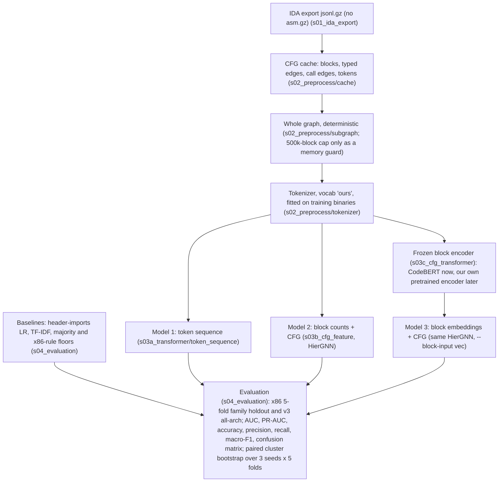

# CT_GAT/pipeline

The ransomware classifiers of this project, from the IDA export of a binary to the tables that compare them. Everything runs
from this folder (`CT_GAT/pipeline`) as `python -m <package>.<module>`; the tests are in `tests/`.

## The pipeline



This is the target architecture adopted on 2026-10-19 ([`docs/history/TEAM_PIPELINES_REVIEW.md`](docs/history/TEAM_PIPELINES_REVIEW.md),
section 9). It drops the `asm.gz` input and the RVA / mnemonic match of the first team diagram (a label-correlated alignment
failure, section 8 of the review) and random subgraph selection (every budget lost to the whole graph), and adds the baselines
and the evaluation boxes.

## The stage folders

| folder | holds | README |
|---|---|---|
| `s01_ida_export/` | the IDAPython extractor that writes the `*.jsonl.gz` CFG export and the `*.asm.gz` listing of a binary (runs inside IDA, on the VM) | [`s01_ida_export/README.md`](s01_ida_export/README.md) |
| `s02_preprocess/` | the team's two preprocessing scripts for the transformer (flat scripts), and the jsonl-only path: `cache/` (CFG cache builder and checker, fold CSVs), `tokenizer/`, `subgraph.py` | [`s02_preprocess/README.md`](s02_preprocess/README.md) |
| `s03a_transformer/` | Model 1, the token-sequence transformer (`token_sequence/`), and Janice Park's five-channel Model 1 (`five_channel/`) | [`s03a_transformer/README.md`](s03a_transformer/README.md) |
| `s03b_cfg_feature/` | Model 2, the hierarchical edge-typed GNN over the block CFG and the call graph (`gnn/`) | [`s03b_cfg_feature/README.md`](s03b_cfg_feature/README.md) |
| `s03c_cfg_transformer/` | Model 3: block export, encoder contract, CodeBERT and reference encoders, precomputed block vectors | [`s03c_cfg_transformer/README.md`](s03c_cfg_transformer/README.md) |
| `s04_evaluation/` | metrics, validation thresholds, the baselines, the paired bootstrap, `report.py` and the gate summaries | [`s04_evaluation/README.md`](s04_evaluation/README.md) |
| `common/` | `RunConfig` (the options of a run and its name), `paths.py` (where the data lives), `manifests.py` (folds), the model registry, `run_io.py` (the run directory every model writes), `reader.py`, `side_io.py` | |
| `experiments/` | `train.py` (the one training command), `queue.py` and `plans/` (the experiments we ran), `stages/` (the gate definitions), `team_pipelines/` (the teammates' GAT pipelines under our folds), `side_arrays/` | [`experiments/team_pipelines/README.md`](experiments/team_pipelines/README.md) |
| `docs/` | [`ADDING_AN_EXPERIMENT.md`](docs/ADDING_AN_EXPERIMENT.md), and `history/`: the plan, the results, the review, the literature review and the final gate tables | [`docs/history/README.md`](docs/history/README.md) |
| `tests/` | the test suite (`pytest.ini` has the markers) | |

## Setup

Python 3.12 and the packages of [`requirements.txt`](requirements.txt) (`pip install --extra-index-url https://download.pytorch.org/whl/cpu
-r requirements.txt` for a CPU machine; install the CUDA build of torch for training). `torch_geometric` is optional: only the
team adapters in `experiments/team_pipelines` use it, and their tests skip without it.

Every input has a default location, so a machine that unzips the two Mendeley collections into `CT_GAT/data/` needs no
configuration file and no environment variable. The datasets are rows of [`common/catalog.py`](common/catalog.py), which
computes every root from its own location and holds no machine path:

| what | default | set elsewhere with (see Overrides) |
|---|---|---|
| collections | `CT_GAT/data/<Collection>/`, a folder with `samples.csv` and `summary.json`, as the Drive zips unpack | `GT_COLLECTIONS` |
| Mendeley bundle | none; `CT_GAT/data/Mendeley_GNN_v1/` is used when it is there | `GT_BUNDLE` |
| fold assignments | `s02_preprocess/folds/folds_mendeley.csv` and `s02_preprocess/folds/v3/`, committed | `GT_FOLDS`, `GT_FOLDS_V3` |
| CFG cache | `CT_GAT/cache/<dataset>/` (gitignored) | `GT_CACHE` |
| run directories, block exports | `runs/` here (gitignored), `<runs>/export` | `GT_RUNS`, `GT_EXPORT` |
| pipeline-B build for `--model fivechannel` | `CT_GAT/processed/cfg_subgraphs` | `--build`, `GT_TEAM_B_BUILD` |
| the team's reader output | none; `import_side --from-cfg` replaces it | `GT_READER_ROOT` |

There are two datasets. `mendeley_x86` (protocols `bundle` and `kfold`) is built from the Mendeley corpus: the 2,411 binaries of
the two Mendeley collections that have a recommended split and are not UPX stubs. `combined_v3` (protocol `kfold_v3`) adds the
corpora `ransomware_balanced` and `balanced_goodware` and starts from the `mendeley_x86` cache. A command without `--cache <name>`
reads the cache of the first dataset whose protocols list its `--protocol`, so `--protocol kfold` reads `mendeley_x86` and
`--protocol kfold_v3` reads `combined_v3`. `python -m common.catalog` prints, per dataset, which collection folders are present,
whether the bundle is configured, whether the cache is built and whether the fold files are found. A new dataset is a row of
`DATASETS` in `common/catalog.py` plus its fold CSV in `s02_preprocess/folds/` ([`docs/ADDING_AN_EXPERIMENT.md`](docs/ADDING_AN_EXPERIMENT.md)).
When something is set in more than one place, the order is environment variable, then `datasets.json`, then the default; see Overrides.

### Input data

The team Google Drive holds the inputs (the root [`README.md`](../../README.md) lists the files). The collection zips unpack into
`CT_GAT/data/`. What each dataset needs:

| dataset | collection folders (zip) | what reads it |
|---|---|---|
| `mendeley_x86` | `Mendeley_Ransomware/` and `Mendeley_Goodware/` (`Mendeley_Ransomware.zip`, `Mendeley_Goodware.zip`), or the bundle `Mendeley_GNN_v1/` (`Mendeley_GNN_v1.zip`) in their place | `s02_preprocess.cache.build_cache`, hence every `kfold` command |
| `combined_v3` | the two above, and `Ransomware_Balanced/` and `Balanced_Goodware/` (`Ransomware_Balanced.zip`, `Balanced_Goodware.zip`) | `build_cache --cache combined_v3`, hence every `kfold_v3` command |

`build_cache` stops before it touches the cache when a folder is missing, and names the folder and the zip. The fold CSVs are in
the repository ([`s02_preprocess/folds/README.md`](s02_preprocess/folds/README.md)); `family_holdout_folds.zip` on the Drive holds the same
files and is not needed. `s02_preprocess.cache.folds` writes folds with the same rule, but not the ones of the published tables
(its docstring says why), so use the committed files to reproduce them.

`--model fivechannel` also reads a folder of pipeline-B `.pt` files, `CT_GAT/processed/cfg_subgraphs`. Fill it with a
`Mendeley_x86_cfg_subgraphs_*` zip unzipped at `CT_GAT/` (`api_vocab.json` goes to `CT_GAT/processed/api_vocab.json`, and the
`<sha256>.pt` files, `channel_embedder.pt`, the manifests and `build_info/` go to `CT_GAT/processed/cfg_subgraphs/`), or with
`build_b --source repo` (step 5 of Running). Keep one build there at a time; the two zips have different vocabularies.

## On-disk layout

```
<cache>/                          the CFG cache of a dataset: CT_GAT/cache/<dataset>/ (GT_CACHE overrides)
    samples/<sample_id>.npz       one binary: token ids, block and function pointers, CFG and call edges, edge kinds
    index.csv  vocab.json         one row per binary (label, arch, family, folds); the global token vocabularies
    vocab_generations.json  build_summary.json  folds_v3.md      what the build did: vocabulary hashes, counts and drops, fold table
    side/imports/  side/yanping/  per-binary side arrays (header imports; the team's operand-role ids)
    side/blockvec/<export>_<encoder>/fold<k>/{keys.npy,vectors.npy,meta.json}      frozen block vectors (stage 3c)
<runs>/                           CT_GAT/pipeline/runs/ (GT_RUNS overrides)
    <RunConfig.name>/             one run: config.json manifest.json vocab.json history.csv val_probs.csv best.pt best_auc.pt
                                  predictions.csv predictions_auc.csv metrics.json
    baselines/<dir>/              the TF-IDF / import baselines: metrics.json predictions.csv [stack_logits.csv]
    export/<name>/                a block export: store/ and fold<k>/ (s03c_cfg_transformer/EXPORT_SCHEMA.md)
    encoders/<name>/fold<k>/best.pt     encoder checkpoints (s03c_cfg_transformer/TRANSFORMER_CONTRACT.md)
    gates_<stage>.md  RESULTS.md  val_threshold.md  subgraph_chain.json         the tables
    logs/  STOP                   the queue's per-line logs and its stop file
```

A run is named by its options (`RunConfig.name`, e.g. `kfold0_x86_gnn-mblk15_s0`: protocol and fold, architecture, model and
the options that differ from the defaults, seed). The name is how the gates find the arms, so it never changes for an existing
option (`tests/test_run_names.py` holds 971 recorded names).

## Running

Every command runs from this folder. `RUNS` in a path means the run directory (`runs/` here, or `GT_RUNS`); the queue does not
repeat a run that already has its `metrics.json`. A run with `--epochs 2` (or `--smoke 8 --device cpu` for Models 1) checks a
setup in a few minutes before a full run. Times are measured on the development machine; where none is given, none was measured.

**0. Data.** Unzip `Mendeley_Ransomware.zip` and `Mendeley_Goodware.zip` into `CT_GAT/data/`, then:

```bash
python -m common.catalog                                         # which collections, caches and fold files are there
```

It prints one block per dataset and always exits 0. On a fresh unzip `mendeley_x86` shows both Mendeley folders present, the
bundle absent and the cache not built; `combined_v3` shows `Ransomware_Balanced` and `Balanced_Goodware` missing. Nothing else is
configured for steps 1 to 7.

**1. Preprocessing.** The CFG cache, once per dataset (CPU, 4 workers; a rerun skips the samples already built):

```bash
python -m s02_preprocess.cache.build_cache                       # mendeley_x86 into CT_GAT/cache/mendeley_x86
python -m s02_preprocess.cache.check_cache                       # every invariant of every sample
python -m s02_preprocess.cache.build_cache --cache combined_v3   # all architectures; needs the two balanced zips (below)
python -m s02_preprocess.cache.check_cache --cache combined_v3
```

The first build takes 200 s for 2,411 samples (244 s with the finalising pass). It prints `2411 eligible, 0 copied from base, 0 already
built, 2411 to build` and a summary with `ok` 2411, 236 binaries dropped for no recommended split, 23 for UPX stubs, the vocabulary
sizes mn 609, sig 1337, api 14509, beh 9, and `vocab_sha` `4ded77e0cd6b...`. The cache is byte-identical to the one the published runs read
(`index.csv`, `vocab.json` and all 2,411 `samples/*.npz`). `--dry` prints the cache, corpora and input paths a build resolves and stops.

The second build needs `Ransomware_Balanced.zip` and `Balanced_Goodware.zip` unzipped into `CT_GAT/data/` and the `mendeley_x86`
cache built first: it copies that cache's `vocab.json` and the Mendeley samples, and builds the other two corpora. It takes 1,307 s
of building (1,494 s in all) for 5,838 samples. One binary, a CIL assembly, fails to build, as it does in the published cache.

The `.pt` samples of pipeline B come from the preprocessed zips or from `build_b` (step 5), or from `preprocess_full.py`
([`s02_preprocess/README.md`](s02_preprocess/README.md)).

**2. Baselines** (CPU, minutes):

```bash
python -m s04_evaluation.baselines --protocol kfold --fold 0 1 2 3 4 --arch x86 --seed 0     # TF-IDF and the floors
python -m s03b_cfg_feature.gnn.s10_unused_import_features.import_side --from-cfg             # the import arrays, from the CFG exports
python -m s04_evaluation.baselines --protocol kfold --fold 0 1 2 3 4 --imports               # header-imports LR
python -m s04_evaluation.baselines --protocol kfold_v3 --fold 0 1 2 3 4 --arch all --seed 0  # needs the combined cache
```

`import_side --from-cfg` reads the header record of each CFG export, so the team's reader output (`GT_READER_ROOT`) is not needed;
it takes 33 s for 2,411 samples and writes `CT_GAT/cache/mendeley_x86/side/imports/`. On those arrays the header-imports baseline
reproduces the published predictions on all five folds (fold 0 AUC 0.9962). What differs for the GNN `--imports header` is in
[`s04_evaluation/README.md`](s04_evaluation/README.md).

**3. Model 2**, the GNN on block token counts (GPU only: `experiments/train.py` moves the GNN to CUDA; one run per fold and seed):

```bash
python -m experiments.train --protocol kfold --fold 0 --seed 0 --model gnn --mask-blocks 0.15                     # R7
python -m experiments.train --protocol kfold --fold 0 --seed 0 --model gnn --mask-blocks 0.15 --control no_edges  # R2
```

**4. Model 3**, the same GNN on frozen CodeBERT block vectors. The block export (CPU, minutes), the encoder checkpoints and the
vectors are made once (`HF_HOME` holds `microsoft/codebert-base`):

```bash
python -m s03c_cfg_transformer.block_export --protocol kfold --arch x86 --out RUNS/export/ours_cap0
python -m s03c_cfg_transformer.encoders.codebert --write-checkpoints --export ours_cap0 --name codebert
python -m s03c_cfg_transformer.precompute_blockvec --encoder-name codebert --export ours_cap0 --folds 0 1 2 3 4
python -m experiments.train --protocol kfold --fold 0 --seed 0 --model gnn --mask-blocks 0.15 --block-input vec --block-vec ours_cap0_codebert
```

The export records `export_sha` `e09971a020a8...`, the value of the published runs.

**5. Model 1**, the transformers over the instruction sequence. `tokenseq` reads the block export of step 4 (GPU for a full run;
`--device cpu --smoke 8` trains 8 binaries for 2 epochs on the CPU, as a check). `fivechannel` is Janice's model (CPU or GPU,
`--device`):

```bash
python -m experiments.train --model tokenseq --protocol kfold --fold 0 --seed 0 --device cpu --smoke 8
python -m experiments.train --model tokenseq --protocol kfold --fold 0 --seed 0                          # on the block export ours_cap0
python -m experiments.train --model tokenseq --protocol kfold --fold 0 --seed 0 --threshold-from oof     # threshold from out-of-fold predictions
python -m experiments.train --model fivechannel --protocol kfold --fold 0 --seed 0 --device cpu --smoke 8
python -m experiments.train --model fivechannel --protocol kfold --fold 0 --seed 0
python -m experiments.train --model fivechannel --protocol kfold --fold 0 --seed 0 --max-instructions 512
python -m s03a_transformer.five_channel.model                     # the five-channel forward pass alone, untrained
```

`--model fivechannel` trains on a folder of pipeline-B `.pt` files and takes the folds from the CFG cache's `index.csv`, so it needs
the cache of step 1 as well. Without `--build` it reads `CT_GAT/processed/cfg_subgraphs`, which is filled in one of two ways:

* the zip `Mendeley_x86_cfg_subgraphs_500blocks_v3.zip` (or the uncapped one), unzipped at `CT_GAT/`;
* `python -m experiments.team_pipelines.build_b --source repo --sample signal --num-blocks 500 --seed 0`, which runs the
  `s02_preprocess` scripts of this repository over the Mendeley collections into an empty `CT_GAT/processed/cfg_subgraphs`. It is
  the published 500-block build (a 60-binary rebuild was identical to it in every stored field), takes about 4 h on the CPU for
  the 1,810 binaries (7.6 s per binary, measured), and resumes from its checkpoint.

**6. The teammates' GAT pipelines** under the same folds: [`experiments/team_pipelines/README.md`](experiments/team_pipelines/README.md)
(needs `torch_geometric`; the builds of the 500-block comparison need the pinned teammate worktrees).

**7. Evaluation.** Each run writes `RUNS/<name>/metrics.json` and its predictions; these read them (`val_threshold` needs `RUNS` to
exist, so it runs after the first baselines):

```bash
python -m s04_evaluation.report                                                       # RESULTS.md: every run
python -m s04_evaluation.val_threshold                                                # re-score at the validation threshold
python -m s04_evaluation.stats --a tfidf --b kfold_x86_gnn-mblk15 --selection auc     # one paired comparison
python -m s04_evaluation.gates --stage model1                                         # a gate summary (one per plan)
python -m s04_evaluation.gates --stage v3                                             # needs the kfold_v3 runs of the combined cache
```

`stats` and `gates` need all five folds of a seed for each arm, and name the missing ones otherwise.

**A whole experiment.** Each file in `experiments/plans/` is one experiment we ran, as `train`, `baselines`, `report`,
`val_threshold` and `gates` lines; its header names the CPU steps to run once before it:

```bash
python -m experiments.queue --plan experiments/plans/day1.txt --dry          # print what would run
python -m experiments.queue --plan experiments/plans/day1.txt --budget-min 600
python -m experiments.queue --stop                                           # stop between lines
```

The queue skips a finished run and retries a failed line once. The plans are `day1`, `day1b`, `v3`, `subgraph`, `paths`,
`paths_codebert`, `vocab`, `imports`, `imports_header`, `noapi`, `team`, `model1`, `model1_variants`, `l2_nocall_seeds` and
`r2_noapi`. [`docs/ADDING_AN_EXPERIMENT.md`](docs/ADDING_AN_EXPERIMENT.md) shows how to add a model, an encoder, a dataset,
a control, a plan and a gates stage, and how to read the tables.

## Overrides

Each default of Setup is a fallback. A setting made in more than one place resolves in this order: environment variable, then
`datasets.json`, then the default of `common/catalog.py`.

* **`datasets.json`** (gitignored; copy [`datasets.json.example`](datasets.json.example) and edit): `name -> {cache, protocols, sources}`.
  `cache` is the folder that `s02_preprocess.cache.build_cache` writes; `protocols` are the `--protocol` values that read it by
  default; `sources` are the raw inputs a cache is built from and the run directory. A relative path is relative to the file. An
  entry that is not named like a catalog dataset adds a dataset; an entry named `mendeley_x86` or `combined_v3` replaces it. The
  file's datasets come first in the order of protocol resolution. `GT_DATASETS` names another file. `--cache <name>` picks a
  dataset of the file or of the catalog (`build_cache`, `check_cache`, `experiments.train`). `common/paths.py` has the order.
* **`GT_CACHE`** (a folder) beats the registry; **`GT_RUNS`** the run directories (default `runs/` here); **`GT_EXPORT`** the
  block exports (default `<runs>/export`).
* **`GT_BUNDLE`, `GT_COLLECTIONS`, `GT_FOLDS`, `GT_FOLDS_V3`, `GT_READER_ROOT`**: the raw inputs of `sources`, each overriding the file.
  `GT_BUNDLE` names the `Mendeley_GNN_v1` bundle, which then replaces the two Mendeley collections; `GT_COLLECTIONS` the folder that
  holds the collections (default `CT_GAT/data`).
* **`GT_TEAM_B_BUILD`** (`sources` key `team_b_build`): the pipeline-B build folder of `<sample_id>.pt` files that `--model fivechannel` reads (`--build` beats it).
* **`HF_HOME`** the Hugging Face home that holds `microsoft/codebert-base` (the CodeBERT encoder loads it offline).
* **`GT_PY`** the interpreter of `experiments.queue`; **`GT_TEAM_GNN_ROOT`, `GT_TEAM_MAIN_ROOT`, `GT_TEAM_ASM_DIR`** the pinned
  teammate worktrees and the listing folder of `experiments/team_pipelines`.

A machine that already has a `datasets.json` keeps resolving every path from it: the file's datasets come first, and a source it
does not set falls back to the catalog.

## Tests

Any machine, no data: `python -m pytest -m "not real_data and not gpu"`. CI runs the same command on every push. With the cache
built, `python -m pytest` also runs the tests marked `real_data`.

## Results

Evaluation: 5-fold family holdout on 1,810 x86 binaries (712 clusters: ransomware families and single goodware binaries), seeds
0 1 2, and a 5,652-binary all-architecture protocol (`kfold_v3`, seed 0); the metrics are AUC, PR-AUC and macro-F1 at the
validation threshold, and differences are paired cluster bootstraps with a pre-registered rule (dAUC >= 0.01 and dmacro-F1 >=
0.02, both intervals above zero).

* The signal is in the tokens and the imports, not in the graph. A bag of blocks over instruction tokens with no edges and no API
  names (R2 noapi) scores AUC 0.981 over 3 seeds, level with the import-table logistic regression (0.985) and with TF-IDF (0.982).
* CFG structure adds nothing the rule accepts: typed edges against no edges is +0.004 AUC [-0.001, +0.010], and shuffled edges
  are worse than none (-0.012).
* A logistic regression on the PE import table ties the typed GNN on x86 (0.985 against 0.986) and on the all-architecture pool
  (0.966 against 0.965), and giving the imports to the GNN adds nothing.
* A third CFG layer, call-graph message passing, CodeBERT block vectors (our Model 3, -0.025 AUC against token counts), the
  token-sequence transformer (Model 1) and the teammates' GATs are all level with or below the no-edge bag of blocks.
* The 500-block cap of the teammates' pipelines costs our own GNN 0.021 to 0.063 AUC.
* Pipeline B after the preprocessing fixes (3 seeds): with every non-library block, Model 3 (pooled block embeddings and
  CFG) reaches 0.981 AUC, level with R7 (+0.002 [-0.005, +0.009]), and Model 2 (77 block features and CFG) 0.970; at 500
  blocks they reach 0.966 and 0.954. Janice's five-channel Model 1 reaches 0.919 to 0.926: it reads the first 128 or 512
  instructions of a binary. Choosing Model 1's threshold on out-of-fold predictions raises its macro-F1 from 0.902 to 0.918.

The tables and their derivation: [`docs/history/RESULTS.md`](docs/history/RESULTS.md) (every run), the "Final results" section of
[`docs/history/PLAN_GNN.md`](docs/history/PLAN_GNN.md), the team-pipeline comparison in
[`docs/history/TEAM_PIPELINES_REVIEW.md`](docs/history/TEAM_PIPELINES_REVIEW.md), the literature behind each design choice in
[`docs/history/LITERATURE_REVIEW.md`](docs/history/LITERATURE_REVIEW.md), and the final gate summaries
([noapi](docs/history/gates_noapi.md), [team](docs/history/gates_team.md), [v3](docs/history/gates_v3.md),
[paths_codebert](docs/history/gates_paths_codebert.md), [model1](docs/history/gates_model1.md), [model1_variants](docs/history/gates_model1_variants.md),
[imports](docs/history/gates_imports_header.md), [subgraph](docs/history/gates_subgraph.md)).
