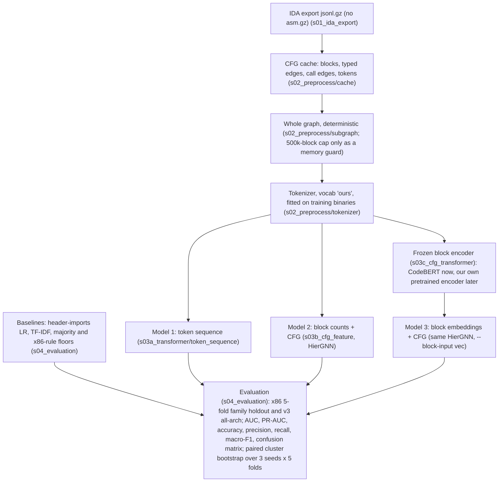

# CT_GAT/pipeline

The ransomware classifiers of this project, from the IDA export of a binary to the tables that compare them. Everything runs
from this folder (`CT_GAT/pipeline`) as `python -m <package>.<module>`; the tests are in `tests/`.

## The pipeline



This is the target architecture adopted on 2026-10-19 ([`docs/history/TEAM_PIPELINES_REVIEW.md`](docs/history/TEAM_PIPELINES_REVIEW.md),
section 9). It drops the `asm.gz` input and the RVA / mnemonic match of the first team diagram (a label-correlated alignment
failure, section 8 of the review) and random subgraph selection (every budget lost to the whole graph), and adds the baselines
and the evaluation boxes.

## The stage folders

| folder | holds | README |
|---|---|---|
| `s01_ida_export/` | the IDAPython extractor that writes the `*.jsonl.gz` CFG export and the `*.asm.gz` listing of a binary (runs inside IDA, on the VM) | [`s01_ida_export/README.md`](s01_ida_export/README.md) |
| `s02_preprocess/` | the team's two preprocessing scripts for the transformer (flat scripts), and the jsonl-only path: `cache/` (CFG cache builder and checker, fold CSVs), `tokenizer/`, `subgraph.py` | [`s02_preprocess/README.md`](s02_preprocess/README.md) |
| `s03a_transformer/` | Model 1, the token-sequence transformer (`token_sequence/`), and Janice Park's five-channel Model 1 (`five_channel/`) | [`s03a_transformer/README.md`](s03a_transformer/README.md) |
| `s03b_cfg_feature/` | Model 2, the hierarchical edge-typed GNN over the block CFG and the call graph (`gnn/`) | [`s03b_cfg_feature/README.md`](s03b_cfg_feature/README.md) |
| `s03c_cfg_transformer/` | Model 3: block export, encoder contract, CodeBERT and reference encoders, precomputed block vectors | [`s03c_cfg_transformer/README.md`](s03c_cfg_transformer/README.md) |
| `s04_evaluation/` | metrics, validation thresholds, the baselines, the paired bootstrap, `report.py` and the gate summaries | [`s04_evaluation/README.md`](s04_evaluation/README.md) |
| `common/` | `RunConfig` (the options of a run and its name), `paths.py` (where the data lives), `manifests.py` (folds), the model registry, `run_io.py` (the run directory every model writes), `reader.py`, `side_io.py` | |
| `experiments/` | `train.py` (the one training command), `queue.py` and `plans/` (the experiments we ran), `stages/` (the gate definitions), `team_pipelines/` (the teammates' GAT pipelines under our folds), `side_arrays/` | [`experiments/team_pipelines/README.md`](experiments/team_pipelines/README.md) |
| `docs/` | [`ADDING_AN_EXPERIMENT.md`](docs/ADDING_AN_EXPERIMENT.md), and `history/`: the plan, the results, the review, the literature review and the final gate tables | [`docs/history/README.md`](docs/history/README.md) |
| `tests/` | the test suite (`pytest.ini` has the markers) | |

## Setup

Python 3.12 and the packages of [`requirements.txt`](requirements.txt) (`pip install --extra-index-url https://download.pytorch.org/whl/cpu
-r requirements.txt` for a CPU machine; install the CUDA build of torch for training). `torch_geometric` is optional: only the
team adapters in `experiments/team_pipelines` use it, and their tests skip without it.

Where the data lives is set per machine, never in the code:

* **`datasets.json`** (gitignored; copy [`datasets.json.example`](datasets.json.example) and edit): `name -> {cache, protocols, sources}`.
  `cache` is the folder that `s02_preprocess.cache.build_cache` writes; `protocols` are the `--protocol` values that read it by
  default; `sources` are the raw inputs a cache is built from and the run directory. A relative path is relative to the file.
  `--cache <name>` picks a dataset, `GT_DATASETS` names another file. `common/paths.py` has the resolution order.
* **`GT_CACHE`** (a folder) beats the registry; **`GT_RUNS`** the run directories (default `runs/` here, gitignored);
  **`GT_EXPORT`** the block exports (default `<runs>/export`).
* **`GT_BUNDLE`, `GT_COLLECTIONS`, `GT_FOLDS`, `GT_FOLDS_V3`, `GT_READER_ROOT`**: the raw inputs of `sources`, each overriding the file.
* **`GT_TEAM_B_BUILD`** (`sources` key `team_b_build`): the pipeline-B build folder of `<sample_id>.pt` files that `--model fivechannel` reads (`--build` beats it).
* **`HF_HOME`** the Hugging Face home that holds `microsoft/codebert-base` (the CodeBERT encoder loads it offline).
* **`GT_PY`** the interpreter of `experiments.queue`; **`GT_TEAM_GNN_ROOT`, `GT_TEAM_MAIN_ROOT`, `GT_TEAM_ASM_DIR`** the pinned
  teammate worktrees and the listing folder of `experiments/team_pipelines`.

### Input data

The team Google Drive holds every input (the root [`README.md`](../../README.md) lists the files). What each source of
`datasets.json` points at:

| source | unzip | what reads it |
|---|---|---|
| `bundle` | `Mendeley_GNN_v1.zip` (the folder that holds `samples.csv`) | `s02_preprocess.cache.build_cache` |
| `folds` | `family_holdout_folds.zip`: `family_holdout/folds_mendeley.csv` | the cache's `index.csv`, hence every `kfold` run |
| `folds_v3` | `family_holdout_folds.zip`: the folder `family_holdout_v3/` | every cache build, x86 included (the `kfold_v3` columns of `index.csv`) |
| `collections` | `Collections/Ransomware_Balanced.zip` and `Balanced_Goodware.zip`, side by side in one folder | the all-architecture cache |
| `team_b_build` | a `Mendeley_x86_cfg_subgraphs_*` zip at `CT_GAT/`: the folder `CT_GAT/processed/cfg_subgraphs` | `--model fivechannel` |

`s02_preprocess.cache.folds` writes folds with the same rule, but not the ones of the published tables (its docstring says
why), so use the zip to reproduce them. The preprocessed zips unzip at `CT_GAT/`: `api_vocab.json` goes to
`CT_GAT/processed/api_vocab.json`, and the `<sha256>.pt` files, `channel_embedder.pt`, the manifests and `build_info/` go to
`CT_GAT/processed/cfg_subgraphs/`. Keep one build there at a time; the two zips have different vocabularies.

## On-disk layout

```
<cache>/                          the CFG cache (GT_CACHE, or the dataset of datasets.json)
    samples/<sample_id>.npz       one binary: token ids, block and function pointers, CFG and call edges, edge kinds
    index.csv  vocab.json         one row per binary (label, arch, family, folds); the global token vocabularies
    side/imports/  side/yanping/  per-binary side arrays (header imports; the team's operand-role ids)
    side/blockvec/<export>_<encoder>/fold<k>/{keys.npy,vectors.npy,meta.json}      frozen block vectors (stage 3c)
<runs>/                           GT_RUNS
    <RunConfig.name>/             one run: config.json manifest.json vocab.json history.csv val_probs.csv best.pt best_auc.pt
                                  predictions.csv predictions_auc.csv metrics.json
    baselines/<dir>/              the TF-IDF / import baselines: metrics.json predictions.csv [stack_logits.csv]
    export/<name>/                a block export: store/ and fold<k>/ (s03c_cfg_transformer/EXPORT_SCHEMA.md)
    encoders/<name>/fold<k>/best.pt     encoder checkpoints (s03c_cfg_transformer/TRANSFORMER_CONTRACT.md)
    gates_<stage>.md  RESULTS.md  val_threshold.md  subgraph_chain.json         the tables
    logs/  STOP                   the queue's per-line logs and its stop file
```

A run is named by its options (`RunConfig.name`, e.g. `kfold0_x86_gnn-mblk15_s0`: protocol and fold, architecture, model and
the options that differ from the defaults, seed). The name is how the gates find the arms, so it never changes for an existing
option (`tests/test_run_names.py` holds 971 recorded names).

## Running

Every command runs from this folder. `RUNS` in a path means the run directory (`GT_RUNS` or the `runs` source); the queue
does not repeat a run that already has its `metrics.json`. A run with `--epochs 2` (or `--smoke 8 --device cpu` for Model 1)
checks a setup in a few minutes before a full run.

**1. Preprocessing.** The CFG cache, once per dataset (CPU; a rerun skips the samples already built):

```bash
python -m s02_preprocess.cache.build_cache                       # kfold x86: the Mendeley bundle
python -m s02_preprocess.cache.check_cache                       # every invariant of every sample
GT_CACHE=<new folder> python -m s02_preprocess.cache.build_cache --corpora mendeley ransomware_balanced balanced_goodware --base-cache <x86 cache>
```

The last line builds the all-architecture cache (`kfold_v3`) into a new folder, reusing the x86 cache's samples; list that
folder as the `cache` of a dataset whose `protocols` are `["kfold_v3"]`, as `combined` in `datasets.json.example`.

The `.pt` samples of pipeline B come from `preprocess_full.py` ([`s02_preprocess/README.md`](s02_preprocess/README.md)) or
from the preprocessed zips.

**2. Baselines** (CPU, minutes):

```bash
python -m s04_evaluation.baselines --protocol kfold --fold 0 1 2 3 4 --arch x86 --seed 0     # TF-IDF and the floors
python -m s04_evaluation.baselines --protocol kfold --fold 0 1 2 3 4 --imports               # header-imports LR
```

**3. Model 2**, the GNN on block token counts (GPU; one run per fold and seed):

```bash
python -m experiments.train --protocol kfold --fold 0 --seed 0 --model gnn --mask-blocks 0.15                     # R7
python -m experiments.train --protocol kfold --fold 0 --seed 0 --model gnn --mask-blocks 0.15 --control no_edges  # R2
```

**4. Model 3**, the same GNN on frozen CodeBERT block vectors. The block export, the encoder checkpoints and the vectors are
made once (`HF_HOME` holds `microsoft/codebert-base`):

```bash
python -m s03c_cfg_transformer.block_export --protocol kfold --arch x86 --out RUNS/export/ours_cap0
python -m s03c_cfg_transformer.encoders.codebert --write-checkpoints --export ours_cap0 --name codebert
python -m s03c_cfg_transformer.precompute_blockvec --encoder-name codebert --export ours_cap0 --folds 0 1 2 3 4
python -m experiments.train --protocol kfold --fold 0 --seed 0 --model gnn --mask-blocks 0.15 --block-input vec --block-vec ours_cap0_codebert
```

**5. Model 1**, the transformers over the instruction sequence:

```bash
python -m experiments.train --model tokenseq --protocol kfold --fold 0 --seed 0                          # on the block export ours_cap0
python -m experiments.train --model tokenseq --protocol kfold --fold 0 --seed 0 --threshold-from oof     # threshold from out-of-fold predictions
python -m experiments.train --model fivechannel --protocol kfold --fold 0 --seed 0 --build ../processed/cfg_subgraphs
python -m experiments.train --model fivechannel --protocol kfold --fold 0 --seed 0 --build ../processed/cfg_subgraphs --max-instructions 512
python -m s03a_transformer.five_channel.model                     # the five-channel forward pass alone, untrained
```

`--model fivechannel` trains Janice's model on a folder of pipeline-B `.pt` files and takes the folds from the CFG cache's
`index.csv`, so it needs the cache of step 1 as well. Without `--build` it reads the `team_b_build` source.

**6. The teammates' GAT pipelines** under the same folds: [`experiments/team_pipelines/README.md`](experiments/team_pipelines/README.md)
(needs `torch_geometric` and the pinned teammate worktrees).

**7. Evaluation.** Each run writes `RUNS/<name>/metrics.json` and its predictions; these read them:

```bash
python -m s04_evaluation.report                                                       # RESULTS.md: every run
python -m s04_evaluation.val_threshold                                                # re-score at the validation threshold
python -m s04_evaluation.stats --a tfidf --b kfold_x86_gnn-mblk15 --selection auc     # one paired comparison
python -m s04_evaluation.gates --stage model1                                         # a gate summary (one per plan)
```

`stats` and `gates` need all five folds of a seed for each arm, and name the missing ones otherwise.

**A whole experiment.** Each file in `experiments/plans/` is one experiment we ran, as `train`, `baselines`, `report`,
`val_threshold` and `gates` lines; its header names the CPU steps to run once before it:

```bash
python -m experiments.queue --plan experiments/plans/day1.txt --dry          # print what would run
python -m experiments.queue --plan experiments/plans/day1.txt --budget-min 600
python -m experiments.queue --stop                                           # stop between lines
```

The queue skips a finished run and retries a failed line once. The plans are `day1`, `day1b`, `v3`, `subgraph`, `paths`,
`paths_codebert`, `vocab`, `imports`, `imports_header`, `noapi`, `team`, `model1`, `model1_variants`, `l2_nocall_seeds` and
`r2_noapi`. [`docs/ADDING_AN_EXPERIMENT.md`](docs/ADDING_AN_EXPERIMENT.md) shows how to add a model, an encoder, a dataset,
a control, a plan and a gates stage, and how to read the tables.

**Tests** (any machine, no data): `python -m pytest -m "not real_data and not gpu"`. CI runs the same command on every push.

## Results

Evaluation: 5-fold family holdout on 1,810 x86 binaries (712 clusters: ransomware families and single goodware binaries), seeds
0 1 2, and a 5,652-binary all-architecture protocol (`kfold_v3`, seed 0); the metrics are AUC, PR-AUC and macro-F1 at the
validation threshold, and differences are paired cluster bootstraps with a pre-registered rule (dAUC >= 0.01 and dmacro-F1 >=
0.02, both intervals above zero).

* The signal is in the tokens and the imports, not in the graph. A bag of blocks over instruction tokens with no edges and no API
  names (R2 noapi) scores AUC 0.981 over 3 seeds, level with the import-table logistic regression (0.985) and with TF-IDF (0.982).
* CFG structure adds nothing the rule accepts: typed edges against no edges is +0.004 AUC [-0.001, +0.010], and shuffled edges
  are worse than none (-0.012).
* A logistic regression on the PE import table ties the typed GNN on x86 (0.985 against 0.986) and on the all-architecture pool
  (0.966 against 0.965), and giving the imports to the GNN adds nothing.
* A third CFG layer, call-graph message passing, CodeBERT block vectors (our Model 3, -0.025 AUC against token counts), the
  token-sequence transformer (Model 1) and the teammates' GATs are all level with or below the no-edge bag of blocks.
* The 500-block cap of the teammates' pipelines costs our own GNN 0.021 to 0.063 AUC.
* Pipeline B after the preprocessing fixes (3 seeds): with every non-library block, Model 3 (pooled block embeddings and
  CFG) reaches 0.981 AUC, level with R7 (+0.002 [-0.005, +0.009]), and Model 2 (77 block features and CFG) 0.970; at 500
  blocks they reach 0.966 and 0.954. Janice's five-channel Model 1 reaches 0.919 to 0.926: it reads the first 128 or 512
  instructions of a binary. Choosing Model 1's threshold on out-of-fold predictions raises its macro-F1 from 0.902 to 0.918.

The tables and their derivation: [`docs/history/RESULTS.md`](docs/history/RESULTS.md) (every run), the "Final results" section of
[`docs/history/PLAN_GNN.md`](docs/history/PLAN_GNN.md), the team-pipeline comparison in
[`docs/history/TEAM_PIPELINES_REVIEW.md`](docs/history/TEAM_PIPELINES_REVIEW.md), the literature behind each design choice in
[`docs/history/LITERATURE_REVIEW.md`](docs/history/LITERATURE_REVIEW.md), and the final gate summaries
([noapi](docs/history/gates_noapi.md), [team](docs/history/gates_team.md), [v3](docs/history/gates_v3.md),
[paths_codebert](docs/history/gates_paths_codebert.md), [model1](docs/history/gates_model1.md), [model1_variants](docs/history/gates_model1_variants.md),
[imports](docs/history/gates_imports_header.md), [subgraph](docs/history/gates_subgraph.md)).
