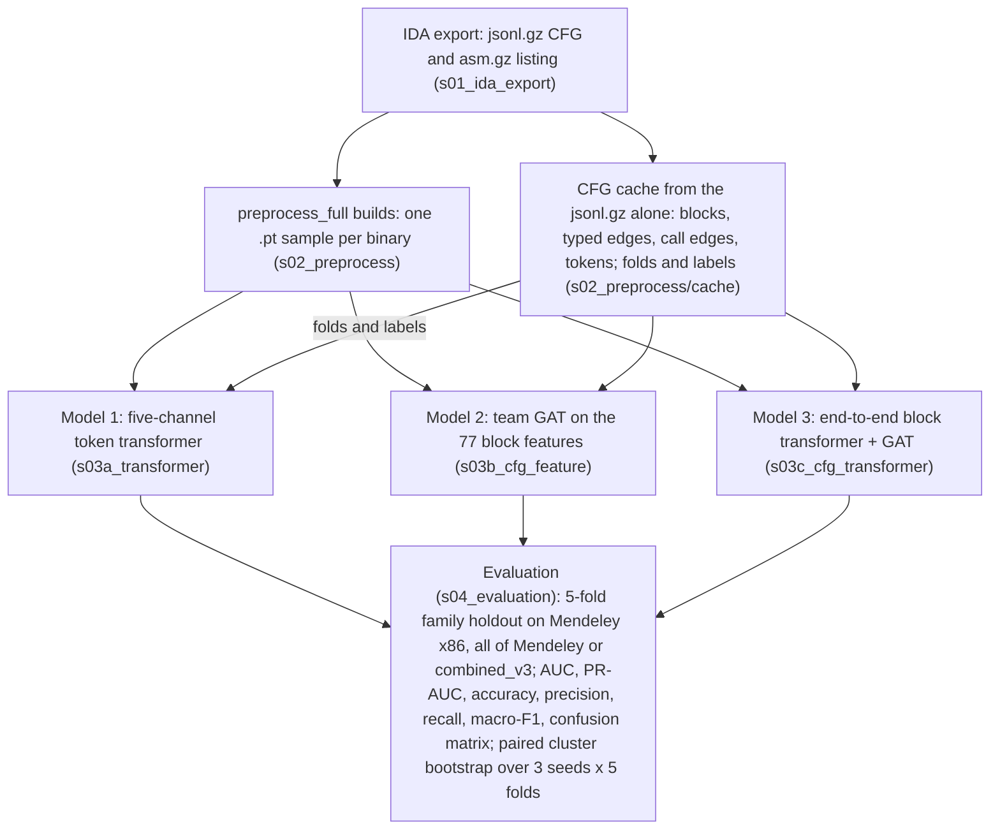

# Pipeline



| Stage | Folder | What it does |
|---|---|---|
| 1. IDA export | `s01_ida_export/` | writes the `.jsonl.gz` CFG export and the `.asm.gz` listing of each binary (inside IDA, on the VM) |
| 2. Preprocessing | `s02_preprocess/` | `preprocess_full.py` selects blocks, aligns their instructions with the listing and writes one `.pt` sample per binary; `cache/` builds the CFG cache, folds and labels from the `.jsonl.gz` exports |
| 3a. Model 1 | `s03a_transformer/` | the five-channel transformer over the instruction sequence |
| 3b. Model 2 | `s03b_cfg_feature/` | the team GAT on the 77 block features |
| 3c. Model 3 | `s03c_cfg_transformer/` | the block transformer trained end to end under the GAT |
| 4. Evaluation | `s04_evaluation/` | metrics, validation thresholds, the paired bootstrap and the result tables |

All folders are under `CT_GAT/pipeline/`.

# Setup

Python 3.12. From the repository root:

```bash
pip install -r CT_GAT/pipeline/requirements.txt
```

This installs the CPU build of PyTorch and `torch_geometric`. For a GPU, first install the CUDA build of torch 2.11.0 from
https://pytorch.org; `requirements.txt` pins that version and would replace another. Model 1 runs on a CPU or a GPU (`--device`); the
full runs of Models 2 and 3 need a CUDA GPU, and their smoke runs use `--device cpu`.

# Data

The zips are on the project Google Drive, each with a `.sha256` file beside it; `README_FIRST.md` there lists them. A collection zip
unzips into `CT_GAT/data/`, a preprocessed zip into `CT_GAT/`.

`CT_GAT/processed/` holds one build, and the zips have different API vocabularies: empty it before unzipping another preprocessed zip.
`train_b` stops when the build's dataset, sampler or block count differs from the arm's. Move the contents of `CT_GAT/processed/cfg_subgraphs` to
`CT_GAT/pipeline/runs/team/<build>`: `b_sig500_v3`, `b_sig250_main`, `b_callwalk500_main`, `b_callwalk250_main` or `b_sigwhole_v3`
for the x86 zips, `b_<family>_mendeley_all` or `b_<family>_combined_v3` for the others (family names: pipeline README), or pass `--build DIR`.

From the repository root, with the zips in it, on Windows (PowerShell or cmd); the other zips unzip like the last one:

```bash
mkdir CT_GAT\data
tar -xf Mendeley_Ransomware.zip -C CT_GAT\data
tar -xf Mendeley_Goodware.zip -C CT_GAT\data
tar -xf Mendeley_x86_cfg_subgraphs_signal_500blocks_v3.zip -C CT_GAT
```

On macOS and Linux, and in Git Bash on Windows, whose `tar` cannot read zips:

```bash
unzip Mendeley_Ransomware.zip -d CT_GAT/data
unzip Mendeley_Goodware.zip -d CT_GAT/data
unzip Mendeley_x86_cfg_subgraphs_signal_500blocks_v3.zip -d CT_GAT
```

A collection zip holds one folder and a preprocessed zip holds `processed/`. In Windows Explorer, set the destination of "Extract All"
to `CT_GAT\data` or `CT_GAT`; the proposed folder is one level too deep. The fold assignments are in the repository. The result is
`CT_GAT/data/<collection>/samples.csv` for each of the four collections, and `CT_GAT/processed/api_vocab.json` and
`CT_GAT/processed/cfg_subgraphs/` for a preprocessed zip.

# Run

Commands run from `CT_GAT/pipeline`. Run outputs go to `CT_GAT/pipeline/runs/` (`RUNS/` in a command); `GT_RUNS` changes it.
`common.catalog` lists the collections, caches and fold files. `build_cache` reads the two Mendeley collections, `check_cache` verifies
the result, and `--cache combined_v3` builds the all-architecture cache (5,838 samples) from the balanced zips and the cache above:

```bash
python -m common.catalog
python -m s02_preprocess.cache.build_cache
python -m s02_preprocess.cache.check_cache
python -m s02_preprocess.cache.build_cache --cache combined_v3
```

## Models


With `--protocol kfold`, `--arch all` trains on the whole Mendeley dataset; with `--protocol kfold_v3`, `--arch all` or `--arch matched`
trains on the combined one. `--arch-balance` weights the training binaries by class and
architecture. On the whole Mendeley dataset the architecture is a proxy for the label (x86: 1,134 ransomware and 676 goodware, x64: 108
and 493; the x86 rule alone scores 0.650 macro-F1, and 55% of the x64 ransomware are in fold 2), so a model gains AUC there by scoring x64
binaries as goodware. Read the recall of ransomware x64 and the cell-balanced metrics (each class and architecture weighted equally), and
take `combined_v3` (x86-rule floor 0.690 on all, 0.606 on matched, 741 x64 ransomware) as the all-architecture test. The commands are
smoke runs on fold 0 for the x86 dataset (a full run omits `--smoke 8 --device cpu`), then runs on the others:

```bash
python -m experiments.train --model fivechannel --protocol kfold --fold 0 --seed 0 --device cpu --smoke 8
python -m experiments.team_pipelines.train_b --arm sig500v3-e2e --fold 0 --seed 0 --smoke 8 --device cpu
python -m experiments.train --model fivechannel --protocol kfold --arch all --fold 0 --seed 0 --build RUNS/team/b_sig500_mendeley_all
python -m experiments.team_pipelines.train_b --arm sig500v3-feat --protocol kfold --arch all --fold 0 --seed 0
python -m experiments.team_pipelines.train_b --arm sig500v3-e2e --protocol kfold_v3 --arch all --fold 0 --seed 0
python -m experiments.train --model fivechannel --protocol kfold_v3 --arch matched --arch-balance --fold 0 --seed 0 --build RUNS/team/b_sig500_combined_v3
```

## Plans and tables

A plan in `experiments/plans/` is one experiment for `experiments.queue`: `model1_variants`, `team_b`, `team_builds` (135 runs),
`team_mendeley_all` (345 runs, whole Mendeley dataset), `team_v3` (390 runs, combined dataset), `team_m1frozen` (90) and `team_v3_m1frozen` (120 runs: Model 3 on a frozen Model 1). `report` writes `RESULTS.md` in the
run directory. `gates` prints the arms of a stage and names the missing folds and seeds; `--stage team` also compares with published
arms, which print as missing unless the published runs are in `GT_RUNS`, and `team_mendeley_all`, `team_v3_all` and `team_v3_matched`
add the recall of each class and architecture. GPU runs differ in the last digits (CUDA scatter is nondeterministic), so compare models
through several seeds. The block prints a plan's runs (`--dry`), writes the tables, checks the arms and runs the tests, with no dataset:

```bash
python -m experiments.queue --plan experiments/plans/team_b.txt --dry
python -m s04_evaluation.report
python -m s04_evaluation.gates --stage team
python -m pytest -m "not real_data and not gpu"
```

# Results

5-fold family holdout on the 1,810 Mendeley x86 binaries; area under the ROC curve (AUC), mean over 3 seeds unless marked. Sources:
[`docs/history/`](CT_GAT/pipeline/docs/history/README.md).

* Model 3 with fixed block embeddings on the uncapped samples (`sigwhole-emb`): 0.981. At 500 blocks per binary (`sig500v3-emb`): 0.966.
  Trained end to end (`sig500v3-e2e`) it has no 3-seed result yet; its plan is `team_b`.
* Model 2 on the uncapped samples (`sigwhole-feat`): 0.970. At 500 blocks per binary (`sig500v3-feat`): 0.954.
* Model 1: 0.919 to 0.926; it reads the first 128 or 512 instructions of each binary.
* Published comparisons, from runs of the earlier jsonl-only code on the branch `jsonl-reference-models`: a logistic regression on the
  PE import table 0.985 (seed 0), TF-IDF over the instruction tokens 0.982 (seed 0), the typed GNN (R7) 0.979; Model 3 on the uncapped
  samples is level with R7 (+0.002 AUC, 95% interval -0.005 to +0.009).

# Further documentation

[`CT_GAT/pipeline/README.md`](CT_GAT/pipeline/README.md) describes the stage folders, the on-disk layout, the overrides,
`build_b --source repo` (a 500-block build in 4 to 5 h), `preprocess_full.py`, the IDA export, and every zip with its size,
checksum and arms. The plan, the result tables and the review are in `docs/history/`.
