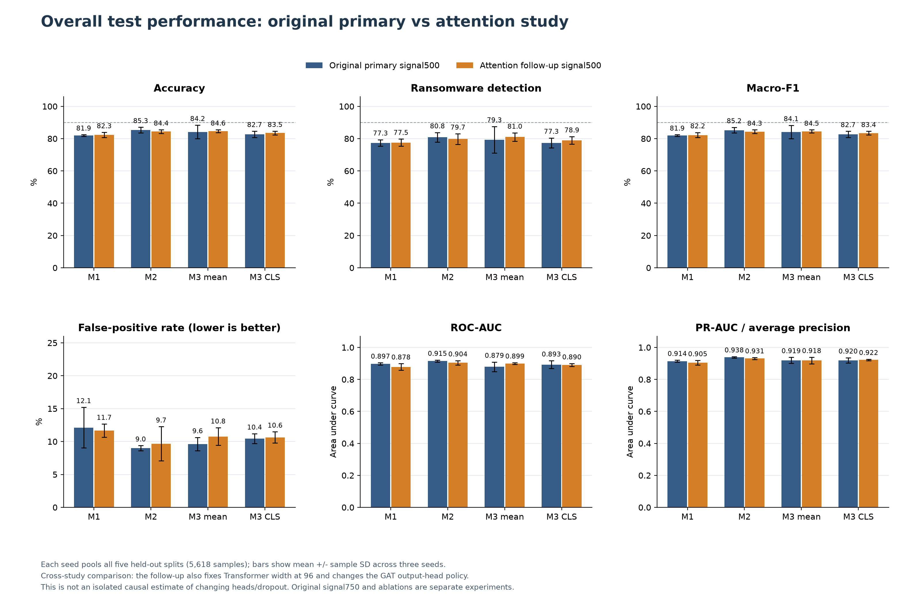
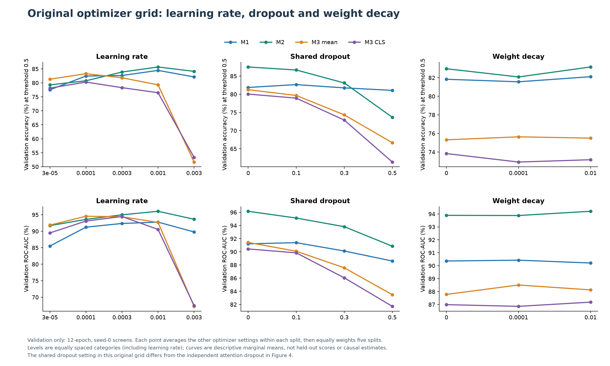
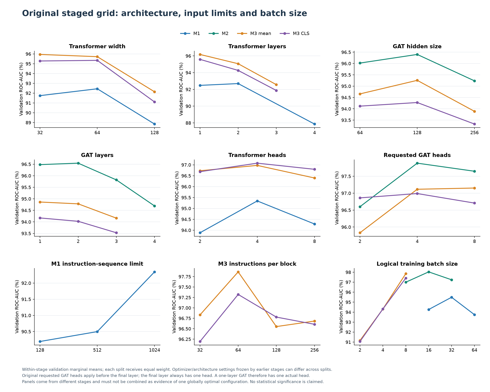
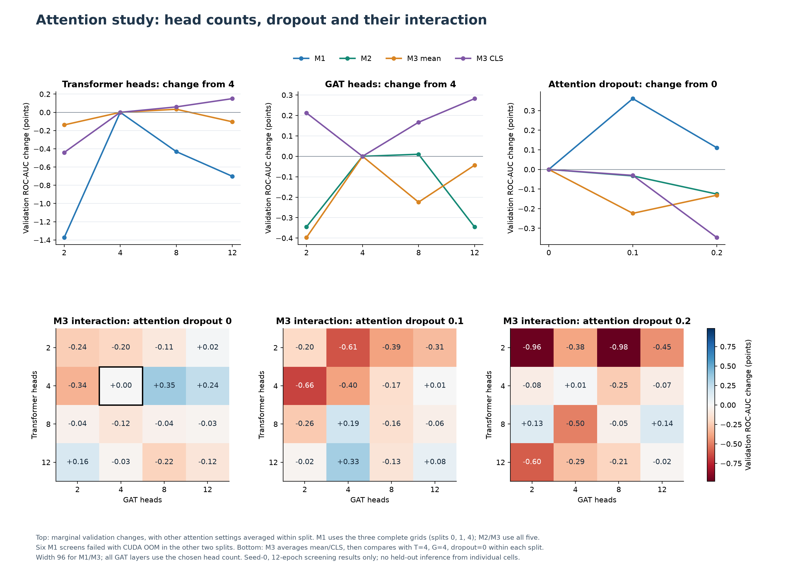
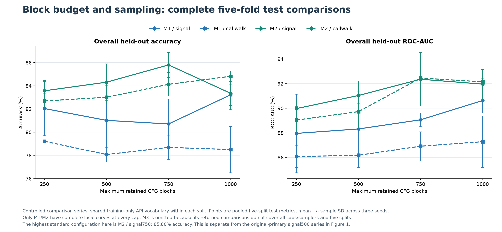

# Hyperparameter performance for Yanping

[Detailed interpretation and limitations](READ_ME_FIRST.txt). Figures use the verified final Excel export. PNG files are ready for slides; the matching `svg/` files retain vector graphics and editable text. Numeric values are in `data/`.

## Overall held-out performance

All five held-out splits, three training seeds. These compare complete configurations; the attention follow-up also changes Transformer width and GAT head policy.



## Learning rate, dropout and weight decay

Original optimizer-stage validation grids, with the other settings averaged within each split before equal split weighting. M3 was sensitive to high learning rates. Heavy shared dropout generally hurt M2/M3; weight decay had a smaller effect.



## Architecture, input limits and batch size

Original staged validation grids. Bigger/deeper was not uniformly better within the short screening budget. Do not assemble one "best configuration" by taking an independent peak from every panel.



## Attention heads and dropout

Within-study validation changes and Model 3 interactions. More heads were not consistently better. M1 uses its three complete attention grids to keep parameter levels comparable; M2/M3 use all five.



## Block counts and sampling

Complete local five-fold held-out comparisons, three seeds. M3 curves are omitted where returned comparison cells are incomplete. M2 signal750 had the highest observed complete standard accuracy, 85.80%.



## Rebuild

From `CT_GAT/pipeline`, with the optional plotting dependencies installed:

```powershell
python -m pip install -r reporting/final_export/plot_requirements.txt
python reporting/final_export/build_hyperparameter_figures.py
```

The default output is the ignored `demo_results/hyperparameter_graphs` folder. This reads the committed final workbook and layout, and does not retrain or change experiment records.
